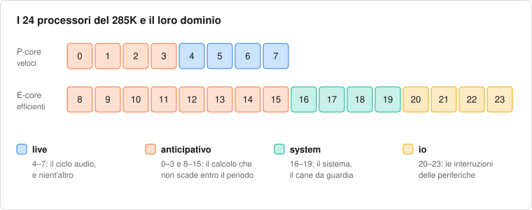

# 1. Il quadro

## Che cos'è dawOS

dawOS è un sistema operativo fatto per una cosa sola: far girare una **DAW**, cioè un programma per registrare, montare e mixare musica (_Digital Audio Workstation_). È costruito su Linux, ma non è una distribuzione Linux su cui si installa una DAW: è un'immagine in cui la DAW è **l'unico programma che ha diritto al tempo reale**, e tutto il resto del sistema è organizzato per non disturbarla.

L'idea di fondo è che in un computer che fa audio il problema non è la potenza, è la **puntualità**. Un processore moderno calcola in un millisecondo ciò che serve per decine di tracce; il guaio è che ogni tanto il sistema operativo decide di fare altro per mezzo millisecondo nel momento sbagliato, e il suono salta. Su un sistema generico quel «ogni tanto» non si può eliminare, solo rendere raro. dawOS parte dall'altra parte: decide prima chi usa quale processore e quando, e lo fa rispettare.

## Perché il suono salta

Una scheda audio consuma i campioni a un ritmo fisso, dettato dal suo orologio: 48 000 al secondo, per esempio. Il programma glieli consegna a blocchi, e deve consegnare ogni blocco **prima** che la scheda abbia finito il precedente. Con blocchi da due millisecondi, il programma ha due millisecondi per svegliarsi, leggere l'ingresso, calcolare tutto e scrivere l'uscita, cinquecento volte al secondo, per ore. Se una volta sola arriva tardi, la scheda resta senza campioni e si sente un _click_: si chiama **xrun**.

Arrivare tardi può voler dire tre cose diverse, e gran parte del progetto consiste nel tenerle separate:

1. **il programma si è svegliato tardi**: il kernel era occupato, o il processore dormiva profondamente;
2. **il programma ha calcolato troppo a lungo**: c'era troppo lavoro, o qualcosa lo ha interrotto mentre calcolava;
3. **la scheda ha detto tardi (o presto) che il blocco era pronto**: il suo orologio e quello del computer non sono lo stesso orologio.

## Come è fatto, in tre strati

**La piattaforma (Fase 0).** Un'immagine di sistema minima, a sola lettura, verificata all'avvio, con un kernel Linux in versione _real-time_. I processori della macchina sono divisi in **domini**: alcuni sono riservati al calcolo dell'audio e il kernel non ci mette nient'altro, altri servono il sistema, altri le interruzioni delle periferiche. La Fase 0 è finita con una campagna di 24 ore sotto carico in cui il ritardo di risveglio sui processori riservati è rimasto sotto 50 microsecondi.

**Il motore (Fase 1, in corso).** `dawos-engine`, scritto in Rust: apre la scheda audio, fa girare un ciclo ogni periodo su ognuno dei processori riservati, calcola un **grafo** di nodi (ingressi, guadagni, somme, filtri, uscite) e misura sé stesso a ogni ciclo. In questa fase non c'è interfaccia: il motore si comanda da riga di comando e stampa rapporti.

**Tutto il resto (fasi successive).** La sessione, i plugin in processi separati, l'interfaccia grafica. Non esistono ancora; molte scelte di oggi sono fatte perché si possano aggiungere senza rifare il motore.

## La macchina di riferimento

Tutte le misure che contano sono fatte su una macchina sola, che nei documenti si chiama **285K**: una scheda madre ASUS ROG STRIX Z890-I con un processore Intel Core Ultra 9 285K _(verificato)_. Ha 24 processori logici, di due tipi: 8 **P-core** (veloci) e 16 **E-core** (più lenti, più efficienti). Non ha _hyper-threading_: un processore logico è un core fisico.

Il **profilo di avvio** `285k` li divide così _(verificato dalla riga di comando del kernel)_:

| Dominio | Processori | A che cosa serve |
| --- | --- | --- |
| **live** | 4–7 (quattro P-core) | Il ciclo audio del motore, e nient'altro |
| **system** | 16–19 | Il sistema, il cane da guardia del motore, i thread di riserva |
| **io** | 20–23 | Le interruzioni delle periferiche, tra cui quella della scheda audio |
| **anticipativo** | 0–3 e 8–15 (quattro P-core e otto E-core) | Il calcolo che non deve essere pronto entro il periodo: in futuro, le tracce non suonate dal vivo |

**Figura 1.1.** I processori del 285K e il dominio di ognuno. I quattro P-core live sono gli unici su cui gira il ciclo audio.

L'interfaccia audio è una Focusrite Scarlett 18i20: prima quella di seconda generazione, dal 24 novembre 2026 quella di quarta, che è l'interfaccia del resto della fase.

Lo sviluppo si fa su un altro computer, il **PC di sviluppo**, dove si costruisce l'immagine e la si prova in una macchina virtuale prima di mandarla al 285K.

## I numeri che contano

| Numero | Che cosa vuol dire | Da dove viene |
| --- | --- | --- |
| **48, 96, 192 kHz** | Le frequenze di campionamento delle prove. Il motore accetta anche 44,1, 88,2 e 176,4 kHz; le ultime due non sono mai state provate sulla scheda | Scelta di progetto |
| **2 ms** | La durata di un periodo, cioè di un ciclo del motore: 96 frame a 48 kHz, 192 a 96 kHz, 384 a 192 kHz | Scelta di progetto: è il **quanto** |
| **3** | I periodi nel buffer della scheda. Con due la scheda resta senza sotto carico | Misurato in P1.12c |
| **10 ms** | La latenza massima ammessa per il giro completo: da un campione che il motore scrive verso l'uscita allo stesso campione riletto dall'ingresso, passando per i convertitori e un cavo (requisito R-01) | Requisito |
| **50 µs** | Il ritardo di risveglio massimo ammesso su un processore live | Criterio della Fase 0 |
| **150 µs** | Il margine: quanto prima della scadenza un thread smette di prendere lavoro | Valore di partenza, da sostituire con uno misurato |
| **6 ms** | Tre periodi: dopo quanto senza progressi un thread è dato per bloccato | Decisione ADR 0023 |
| **10, 40, 150 ns per frame** | Il costo delle tre classi del «plugin» di riferimento | Decisione ADR 0011 |
| **60 %** | La quota massima di un processore live che la sessione di riferimento può occupare | Requisito R-04 |

## Il metodo

Il lavoro procede **un passo alla volta**, e ogni passo ha la stessa forma:

1. si scrive che cosa si farà, con le scelte e le alternative scartate;
2. si scrive **che cosa ci si aspetta di misurare**, prima di misurare;
3. si misura sul 285K, e i file delle misure finiscono nel repository;
4. si scrive l'esito, **compreso ciò che non è andato come previsto**;
5. il passo si chiude con un'etichetta nel repository (`p1.7d`, per esempio), e solo allora si passa al successivo.

Il punto 2 è quello che rende utile il punto 4. Una previsione scritta prima non si può aggiustare dopo: se la misura la smentisce, si impara qualcosa. Il [capitolo 5](05-errori-e-stime.md) raccoglie quelle smentite.

Due regole di scrittura tengono onesto il resto: ogni numero porta scritto se è _(verificato)_, _(stima)_ o _(ipotesi)_; e un difetto di cui non si conosce la causa **non si chiude come «caso»**, diventa un punto aperto (`docs/02-punti-aperti.md`) con ciò che si è visto e che cosa guardare se ricapita.

## Come proseguire

Il [capitolo 2](02-i-concetti.md) spiega i concetti uno per uno. Chi preferisce la cronaca può andare al [capitolo 4](04-la-storia.md) e tornare ai concetti quando servono.
