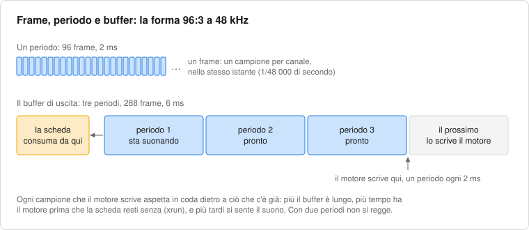
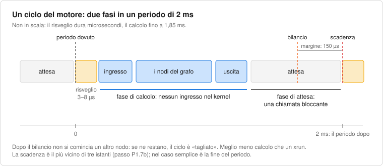
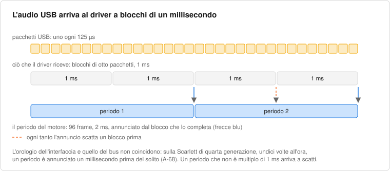
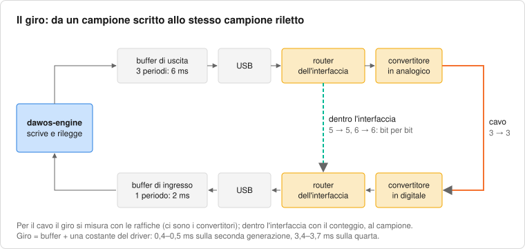
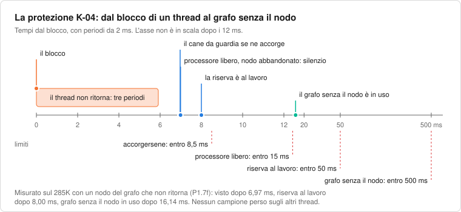
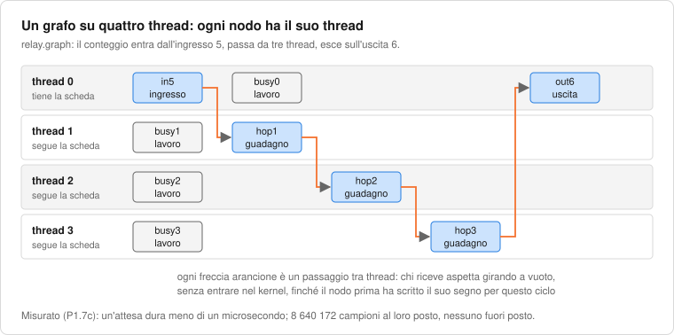
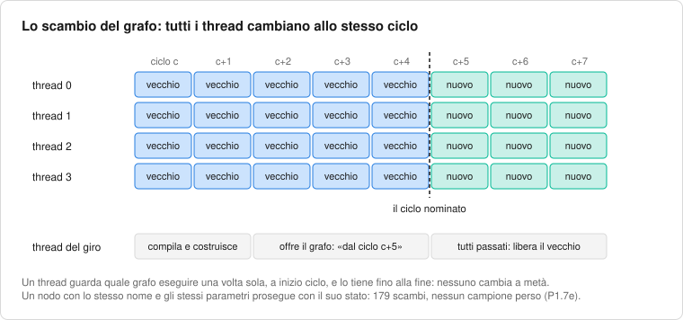
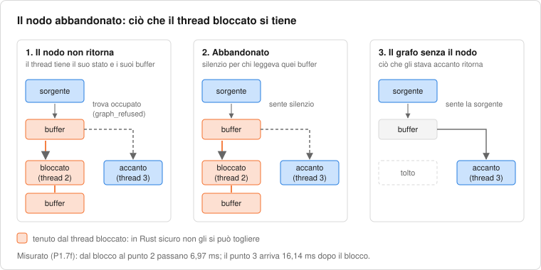
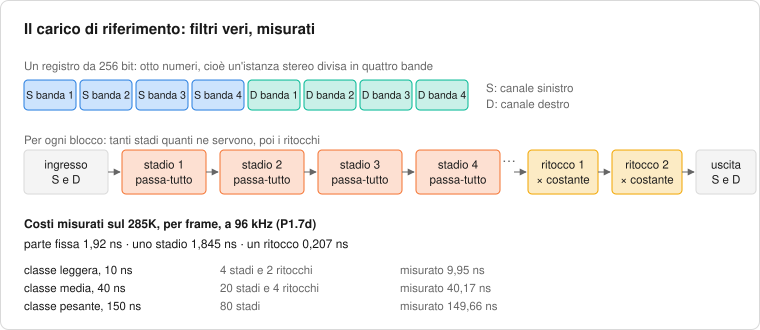

# 2. I concetti

Dal basso verso l'alto: prima il suono come numeri, poi il tempo, poi la macchina, la scheda, il motore, il grafo e il calcolo. Ogni sezione dice anche **dove nel progetto** quel concetto è diventato una misura o una decisione.

## L'audio come numeri

**Campione.** Il valore del segnale in un istante, un numero. La scheda ne produce e ne consuma tanti al secondo quanti ne dice la **frequenza di campionamento**: 48 000 a 48 kHz.

**Frame.** I campioni di tutti i canali nello stesso istante. Una scheda con 26 ingressi dà 26 campioni per frame. Quando si dice «96 frame» si intende 96 istanti, qualunque sia il numero di canali. I costi del calcolo nel progetto sono detti **per frame**.

**Formato.** La scheda dà e prende interi a 32 bit di cui 24 significativi. Dentro il motore i campioni sono in **virgola mobile a 32 bit**, con il fondo scala a 1. Un intero a 24 bit sta esatto in un numero in virgola mobile a 32 bit: per questo un segnale che attraversa il motore senza essere toccato esce identico al bit, ed è una cosa che si prova (vedi il conteggio, più sotto).

**Decibel.** Un rapporto di livelli in scala logaritmica: 20 × log₁₀ del rapporto tra le ampiezze. −6 dB è circa la metà, −20 dB un decimo. **dBFS** è il livello rispetto al fondo scala: 0 dBFS è il massimo rappresentabile, −12 dBFS un quarto.

**Periodo e quanto.** La scheda non scambia i campioni uno alla volta ma a blocchi. Un blocco è un **periodo**; la sua lunghezza in frame, nel progetto, si chiama **quanto**. Il motore lavora a periodi di **2 millisecondi**: 96 frame a 48 kHz, 192 a 96 kHz, 384 a 192 kHz. Un periodo è un giro del ciclo del motore.

**Buffer.** La coda di campioni tra il programma e la scheda, lunga un numero intero di periodi. La «forma» `96:3` vuol dire periodi da 96 frame, tre periodi nel buffer. Più è lunga, più tempo ha il programma prima che la scheda resti senza; ma ogni campione ci passa dentro, e quindi più è lunga, più tardi si sente.



**Figura 2.1.** Frame, periodo e buffer con la forma `96:3`. La scheda consuma da una parte, il motore scrive dall'altra.

**Latenza.** Il tempo tra un suono che entra e lo stesso suono che esce. È la somma di ciò che sta nei buffer in ingresso e in uscita, dei convertitori della scheda e di ciò che il bus USB aggiunge. Per chi suona ascoltandosi conta: sopra una decina di millisecondi si sente il ritardo. Il requisito **R-01** chiede di restare entro 10 ms.

**Xrun.** La scheda è rimasta senza campioni da suonare (_underrun_) o senza posto per quelli registrati (_overrun_). È il difetto che si sente. Il driver ferma i flussi, il programma li deve far ripartire: si chiama **recupero**.

**Slittamento.** Un difetto più subdolo dell'xrun: senza che nessuno segnali nulla, qualche campione sparisce o viene inventato, e il segnale si sposta nel tempo di uno o più campioni. Si è visto sulla Scarlett di seconda generazione (punto aperto A-58). Per trovarlo servono strumenti apposta: un tono con un numero intero di cicli nel quanto, o il conteggio.

## Il tempo reale

**Tempo reale** non vuol dire «veloce»: vuol dire che una scadenza è rispettata **sempre**, non in media. Un sistema che risponde in 10 µs il 99,99 % delle volte e in 5 ms una volta su diecimila non è in tempo reale, per l'audio: a 500 cicli al secondo, una volta su diecimila è ogni venti secondi.

**Latenza di schedulazione.** Il tempo tra l'istante in cui un thread dovrebbe ripartire (un timer scade, un'interruzione arriva) e quello in cui riparte davvero. È la prima cosa che la Fase 0 ha misurato. Nel progetto si chiama anche **ritardo di risveglio**.

**PREEMPT_RT.** La variante di Linux in cui quasi tutto il kernel può essere interrotto per far passare un thread più urgente, anche i gestori delle interruzioni, che diventano thread con una priorità. dawOS usa Linux 6.18 con questa opzione.

**Priorità real-time (SCHED_FIFO).** Una classe di schedulazione in cui il thread con la priorità più alta gira finché non cede lui. I thread live del motore sono a priorità 80, il cane da guardia a 95. È potente e pericolosa: un thread FIFO che non cede mai tiene il suo processore per sempre, ed è il rischio K-04.

**Isolamento dei processori.** Tre opzioni della riga di comando del kernel tengono il sistema lontano dai processori live:

- `isolcpus`: lo schedulatore non ci mette nessun thread di sua iniziativa;
- `nohz_full`: niente interruzione periodica del timer finché ci gira un thread solo;
- `rcu_nocbs`: i lavori di pulizia del kernel (RCU) si fanno altrove.

In più `irqaffinity` manda le interruzioni delle periferiche su altri processori (il dominio `io`).

**Stati di riposo (C-state).** Un processore fermo si spegne a strati per consumare meno; più è profondo il riposo, più tempo serve per svegliarsi. Sui processori live il riposo profondo è vietato: il ritardo di risveglio che costerebbe è più lungo di ciò che ci si può permettere (ADR 0009).

**SMI e rumore dell'hardware.** Il firmware della scheda madre può fermare tutti i processori per fare i fatti suoi, senza che il sistema operativo lo sappia (_System Management Interrupt_). È rumore che nessuna configurazione di Linux toglie: va misurato sulla macchina, ed è stato fatto nella Fase 0.

**P-core ed E-core.** I due tipi di core del 285K. Misurato nella Fase 0 (esperimento E-06): su codice audio vettoriale un E-core vale poco più di mezzo P-core alla stessa frequenza.

**Frequenza fissa.** Un processore moderno cambia frequenza di continuo secondo il lavoro, e un cambio costa tempo. I processori live sono fissati a 4,6 GHz, e i P-core dell'altro dominio al loro massimo: si è misurato (P0.6d) che un P-core vicino lasciato scendere a bassa frequenza rallenta il risveglio dei processori live.

**Limite di potenza e protezione termica.** Il processore può essere tenuto sotto una potenza massima (i limiti **RAPL**: 160 W sul 285K). Se arriva comunque troppo caldo, intorno ai 100 °C, rallenta da solo (_throttling_): per l'audio è un difetto, quindi il limite è scelto perché non succeda.

**Fair server.** Una protezione del kernel: su un processore tenuto da thread real-time riserva comunque 50 ms al secondo ai processi normali, perché non muoiano di fame. Per farlo arma un timer, cioè un'interruzione al secondo su ogni processore live. Su quei processori è **spento** (P0.6a, P0.6b): il prezzo è che un thread live che non cede mai blocca tutto ciò che gira lì, ed è da qui che nasce la protezione K-04.

**Chiamate tra processori (IPI).** Un processore può interromperne un altro per chiedergli di fare qualcosa: rifare la schedulazione, svuotare una cache, eseguire una funzione. Arrivano anche sui processori isolati. Il caso che resta sul 285K: quando il kernel **riscrive il proprio codice** (carica un modulo, accende una traccia) chiede a tutti i processori di sincronizzarsi, con la funzione `do_sync_core`. Sono 72 ingressi all'ora per processore live, meno di 2 µs l'uno _(verificato in P1.6e)_. Regola che ne viene: ciò che fa riscrivere il codice al kernel si fa **prima** che l'audio parta.

Altri due casi, visti in P1.7g. Quando un processo restituisce o sposta memoria, il kernel fa **svuotare la TLB** (la cache delle traduzioni degli indirizzi) a tutti i processori su cui quel processo ha thread, con `flush_tlb_func`: il motore lo provoca a sé stesso tre volte all'ora per processore live (A-75). E quando il kernel carica un **programma BPF classico** (un filtro delle chiamate di sistema, come quello che il server SSH installa a ogni connessione) fa ripulire il **predittore dei salti** a tutti i processori, con `__bpf_arch_ibpb`: è una difesa contro gli attacchi di tipo Spectre, e arriva anche ai live (A-76).

**Migrazione dei timer.** Il kernel può spostare la gestione di un timer su un altro processore per lasciar dormire quello che lo ha armato. Per un thread live vuol dire essere svegliato «attraverso» due processori, con qualche microsecondo in più e ogni tanto molti di più. Nel profilo è spenta (`kernel.timer_migration=0`, dal passo P1.6c).

**Fase di attesa e fase di calcolo.** La regola su cui si regge il motore (ADR 0021): un thread live fa **una sola chiamata bloccante per ciclo**, quella con cui aspetta il periodo. Da lì alla fine del calcolo non entra più nel kernel: niente chiamate di sistema, niente allocazioni di memoria, niente attese su lucchetti. Ogni ingresso nel kernel è un punto in cui il thread può essere trattenuto per un tempo che non controlla.



**Figura 2.2.** Un ciclo del motore. Tra il risveglio e la fine dell'uscita il thread non entra nel kernel.

**Syscall User Dispatch.** Un meccanismo di Linux con cui un thread chiede al kernel di **fermare le proprie chiamate di sistema** e di consegnargli un segnale al loro posto. Il motore lo accende durante la fase di calcolo: una chiamata fatta lì viene fermata, contata, riconosciuta per nome e poi eseguita. Così la regola delle due fasi non è una promessa, è una cosa che il verdetto `compute:` controlla a ogni giro.

**Orologi che non coincidono.** Il computer conta il tempo con il suo quarzo, la scheda audio con il proprio, il bus USB con un terzo. Differiscono di qualche parte per milione. Non è un difetto, ma fa sì che ogni tanto un periodo sia annunciato un po' prima o un po' dopo del solito: è il punto aperto A-68.

## La piattaforma

**Buildroot.** Lo strumento che costruisce l'intera immagine (kernel, librerie, programmi) dai sorgenti, in modo ripetibile. L'immagine di dawOS è piccola: poche decine di megabyte.

**Immagine a sola lettura, verificata.** Il sistema sta in un file system compresso a sola lettura (**erofs**), e ogni blocco letto dal disco è controllato contro un albero di impronte (**dm-verity**): se un bit sul disco cambia, il sistema se ne accorge. La radice di quell'albero sta nella riga di comando del kernel, che è firmata.

**UKI e Secure Boot.** Kernel e riga di comando sono impacchettati in un solo file firmato (_Unified Kernel Image_). Il firmware della macchina, con **Secure Boot**, avvia solo file firmati con la chiave del progetto.

**Due slot (A/B).** Sul disco c'è posto per due immagini. Un aggiornamento si scrive in quella non in uso e si prova al riavvio: se il nuovo sistema non arriva a dichiararsi sano entro tre tentativi, il caricatore torna da solo a quello di prima.

**Gruppi di controllo (cgroup).** Il modo in cui Linux raggruppa i processi e assegna a ogni gruppo processori e memoria. In dawOS ogni dominio è un gruppo: un processo del sistema non può finire su un processore live nemmeno se lo chiede.

**La grafica integrata e il suo driver.** Il processore ha una scheda grafica dentro. Se il firmware la accende (c'è uno schermo collegato) e nessun driver la prende in carico, disturba i processori live: è stata la causa delle pause da 18–20 µs della campagna della Fase 0, trovata nel passo P1.0. Il driver `xe` si carica a ogni avvio (ADR 0022).

**Profilo di avvio.** L'insieme delle opzioni del kernel che dipendono dalla macchina, cioè quali processori vanno a quale dominio. `285k` è il profilo della macchina di riferimento; `generic` non isola nulla.

**Macchina virtuale di prova.** Prima di andare sul 285K l'immagine viene avviata in QEMU sul PC di sviluppo. Lì si prova la **logica** (il sistema parte, il motore suona su una scheda fatta di software, la protezione scatta), non i **tempi**: una macchina virtuale non tiene il tempo. Con KVM gira alla velocità del processore vero; senza (emulazione) è decine di volte più lenta, e le istruzioni vettoriali centinaia.

## La scheda audio

**ALSA.** L'interfaccia di Linux verso le schede audio. Il motore apre la scheda direttamente (`hw:`), senza server audio in mezzo.

**USB audio.** Sul bus USB l'audio viaggia in pacchetti a cadenza fissa: uno ogni 125 µs (_microframe_). Il driver di Linux li raggruppa in **URB**; per l'ingresso, in blocchi di otto pacchetti, cioè un millisecondo. Ne segue che il driver «vede» arrivare l'audio **a scatti di un millisecondo**: un periodo che non è un multiplo di un millisecondo arriva a intervalli irregolari.



**Figura 2.3.** Perché il periodo arriva «a scatti»: il driver vede l'audio a blocchi di un millisecondo.

**Periodo del driver e ciclo del motore.** Non devono per forza coincidere. Il driver USB dimensiona i suoi blocchi sul periodo che gli si chiede: al più un millisecondo, e comunque più corti di un periodo. Chiedendogli un periodo più corto del ciclo del motore (una **fetta**: metà, un quarto, un ottavo) i blocchi si accorciano fino a un pacchetto solo, e i campioni aspettano meno in entrata e in uscita; il motore continua a svegliarsi una volta per ciclo. Il prezzo: più interruzioni USB, e meno scorta nel driver se il sistema si ferma un momento. È ciò che misura il passo P1.8a.

**L'anticipo del controller USB.** Un trasferimento audio va consegnato al controller prima che il suo primo pacchetto parta. Il controller del 285K dichiara di volerlo 0,5 ms prima (in sigla, IST); il suo driver, `xhci-hcd`, dà a ogni trasferimento il numero del millisecondo in cui parte, arrotonda in su e aggiunge un millisecondo di prudenza: tra 1,6 e 2,5 ms. I campioni sono già stati copiati nel trasferimento, quindi quel tempo è latenza. Sommato alla durata del trasferimento fa i tre millisecondi che la quarta generazione ha più della seconda (P1.8b). Sta sotto il driver audio: vale per qualunque driver audio.

**Retroazione implicita.** Il modo in cui la Scarlett tiene in passo uscita e ingresso: il computer manda in uscita tanti campioni quanti ne ha appena ricevuti in ingresso. Funziona, ma il driver di Linux in questa modalità rinuncia a un'ottimizzazione di latenza: sulla quarta generazione il giro dentro il computer è 3,5 ms più lungo che sulla seconda (punto aperto A-69). Dal passo P1.8b si sa dove: tre millisecondi sono il tempo dell'uscita presso il controller USB.

**Routing e loopback.** La Scarlett ha un mixer interno che decide quale segnale va dove. Per le prove serve che un'uscita torni su un ingresso: **con un cavo** (uscita 3 → ingresso 3, attraverso i convertitori) o **dentro l'interfaccia**, senza convertitori, bit per bit (canali 5 e 6). I file `*.test-loop.conf` mettono l'interfaccia in questo stato e la prova lo ripristina alla fine.



**Figura 2.4.** I due giri delle prove: per il cavo, attraverso i convertitori, e dentro l'interfaccia, bit per bit.

**fcp-server.** La Scarlett di quarta generazione si comanda con un protocollo di Focusrite (FCP). Il kernel porta solo i messaggi; un programma, `fcp-server`, li traduce in controlli che ALSA mostra. Senza di lui il mixer dell'interfaccia non si può configurare.

**Scheda di software (snd-aloop).** Un modulo del kernel che finge una scheda in cui ogni uscita è collegata all'ingresso con lo stesso numero. Serve nella macchina virtuale, dove non c'è un'interfaccia vera.

**Assestamento.** Dopo un cambio di frequenza di campionamento l'interfaccia ci mette qualche secondo a stabilizzarsi, e nel primo minuto può fermare i flussi. Per questo le prove hanno un **riscaldamento** (_warm-up_): ciò che succede lì è contato a parte e non giudicato.

## Il motore

**Thread live.** Un thread per ogni processore del dominio live, inchiodato al suo processore, a priorità real-time. Tutti fanno lo stesso ciclo allo stesso ritmo.

**Slot.** Il posto di un thread live nel motore: lo slot 0 è quello che **tiene la scheda** (legge l'ingresso e scrive l'uscita), gli altri lo **seguono**: dormono su un timer della scheda stessa e prendono il numero del ciclo dal primo.

**Il ciclo.** Per ogni periodo: aspettare (fase di attesa), poi leggere l'ingresso, eseguire i propri nodi, consegnare l'uscita (fase di calcolo), poi di nuovo aspettare. Tutti i thread contano gli stessi cicli con lo stesso numero.

**Bilancio di calcolo e margine.** Un ciclo deve finire entro una scadenza. Il thread, prima di cominciare un nodo, guarda l'orologio: se manca meno del **margine** (150 µs) alla scadenza, non lo comincia, e il ciclo è **tagliato** (_cut_, o _incomplete_). Meglio un ciclo con meno calcolo che un xrun. Dal passo P1.7b la scadenza è il più vicino di tre istanti: un periodo dopo l'inizio vero del ciclo; mezzo periodo dopo la fine del proprio periodo; l'istante in cui la scheda avrebbe suonato tutto ciò che aveva.

**Ciclo partito indietro.** Un ciclo il cui periodo era già scaduto quando il ciclo prima è finito: il thread non ha dormito. Non è un risveglio tardivo, ed è contato a parte (colonna `behind`).

**Il cane da guardia e la protezione K-04.** Un thread su un processore del dominio `system`, a priorità più alta di tutti, guarda i thread live. Se uno non fa progressi per tre periodi lo considera bloccato: gli toglie la priorità, lo sposta via dal processore live e manda al suo posto un **thread di riserva** (_spare_), tenuto pronto da prima. I limiti: accorgersene entro 8,5 ms, liberare il processore entro 15 ms, riserva al lavoro entro 50 ms (ADR 0023). Se anche il cane da guardia si ferma, interviene systemd, che riavvia il motore.



**Figura 2.5.** La protezione K-04: che cosa succede, e entro quando, dopo che un thread smette di ritornare.

**Il registro di ogni ciclo.** Ogni thread scrive per ogni ciclo una riga (quando doveva svegliarsi, quando si è svegliato, quanto ha calcolato, che cosa è successo) in un anello di memoria senza lucchetti; un thread non real-time li legge e ne fa le statistiche. È lo strumento con cui si giudica tutto il resto.

**Il pezzo del suono (_patch_).** Gli strumenti di misura che lavorano sui blocchi della scheda accanto al grafo: il tono, il conteggio, le raffiche, l'ascolto. Sono descritti nel [capitolo 3](03-le-prove.md#gli-strumenti-di-misura-dentro-il-motore).

## Il grafo

**Grafo.** Ciò che il motore calcola in un ciclo: **nodi** collegati tra loro, ognuno con ingressi e uscite che portano un canale di suono. Un nodo può essere un ingresso o un'uscita della scheda, un guadagno, una somma, un bus, una linea di ritardo, un generatore, un misuratore, un carico.

**Descrizione.** Un file di testo, una riga per nodo e una per ogni catena di collegamenti:

```text
input   in3    channel=3
gain    piano  db=-6
output  out5   channel=5
connect in3 -> piano -> out5
```

I tipi di nodo che esistono oggi, con ciò che costano sul 285K a 96 kHz, cioè per un quanto di 192 frame _(verificato, passi P1.7d e P1.7e)_:

| Tipo | Parola nel file | Che cosa fa | Costo per quanto |
| --- | --- | --- | --- |
| Ingresso, uscita | `input`, `output` | Un canale della scheda, sul thread che la tiene | Non misurato a parte |
| Guadagno | `gain` | Moltiplica per una costante | 0,06 µs |
| Somma | `sum` | Somma i suoi ingressi | 0,08 µs con due ingressi, 0,17 con otto |
| Bus | `bus` | Somma in doppia precisione, per molti ingressi | 0,12 µs con due ingressi, 0,27 con otto |
| Ritardo | `delay` | Restituisce ciò che ha ricevuto tanti frame prima | 0,23 µs |
| Sinusoide, impulso, rumore | `sine`, `impulse`, `noise` | Generatori di prova | 1,49, 0,13 e 0,36 µs |
| Misuratore | `peak` | Ricorda il picco più alto che ha visto | 0,40 µs |
| Carico | `load` | Filtri veri, in tre classi: è il «plugin» di riferimento | 2,0, 7,8 e 28,7 µs |
| Attesa a vuoto | `spin` | Tiene occupato il processore per un tempo esatto: per le prove | Quello che dichiara |
| Trappola | `trap` | Dopo un certo tempo non ritorna più: per provare la protezione | Come un guadagno, finché funziona |

**Compilazione.** Fuori dal tempo reale, la descrizione viene controllata, messa in un ordine in cui ogni nodo viene dopo quelli da cui dipende, e ogni nodo viene **assegnato a un thread** per sempre. A ogni uscita di nodo viene dato un **buffer**.

**Assegnazione statica.** La decisione D-10 (ADR 0025): ogni nodo ha il suo thread, deciso alla compilazione. L'alternativa, una coda comune da cui pesca il primo thread libero, sfrutta meglio i processori ma rende i tempi meno ripetibili, e non permetterebbe a un plugin in un altro processo di sapere su quale processore aspettare.

**Segmento.** Una catena di nodi in cui ognuno aspetta solo il precedente: va per intero su un thread, perché spezzarla non farebbe guadagnare nulla.

**Costo atteso.** Quanto il compilatore pensa che un nodo impieghi. All'inizio erano stime; dal passo P1.7d sono misure.

**Lavoro, percorso critico, durata.** Tre numeri che il compilatore calcola:

- il **lavoro** è la somma dei costi di tutti i nodi: quanto durerebbe il ciclo su un thread solo;
- il **percorso critico** è la catena più lunga di nodi che si aspettano l'un l'altro: nessun numero di thread fa durare il ciclo meno di così;
- la **durata** (_makespan_) è quanto dura il ciclo con l'assegnazione scelta.

**Accelerazione** (_speed-up_). Il rapporto tra la durata su un thread e quella su N. Con quattro thread il massimo è 4; ciò che si perde è lavoro che non si divide bene e attese tra thread.

**Attesa attiva.** Quando un nodo ha bisogno di un ingresso che un altro thread non ha ancora scritto, il thread **non dorme**: gira a vuoto rileggendo un segno in memoria finché l'ingresso c'è, o finché il bilancio è finito. Dormire vorrebbe dire entrare nel kernel. Il prezzo è un processore tenuto sveglio (rischio K-23); misurate, le attese durano dal mezzo microsecondo ai pochi microsecondi.



**Figura 2.6.** Un grafo su quattro thread: ogni nodo sta sul suo, e le frecce arancioni sono i passaggi in cui un thread aspetta l'altro.

**Il segno.** Ogni nodo porta il numero dell'ultimo ciclo per cui è stato eseguito. Chi aspetta legge quel numero: uguale al ciclo corrente, l'ingresso è pronto; minore, non ancora; maggiore, chi aspetta è rimasto indietro e ciò che aspetta non arriverà.

**Lucchetti solo tentati.** I buffer e lo stato dei nodi stanno dietro lucchetti che il motore **prova** a prendere e non aspetta mai. Per come è fatto il grafo nessuno li tiene quando un altro li chiede; se succede, chi chiede prosegue senza e l'evento è contato (`graph_refused`). Così il crate del grafo non ha una riga di codice `unsafe`.

**Cella.** Ciò che un nodo è da un ciclo all'altro: la memoria dei filtri, la linea di ritardo, la fase di un oscillatore, il picco visto, il segno, i tempi misurati.

**Scambio del grafo.** Sostituire il grafo mentre il ciclo gira. Il grafo nuovo si costruisce fuori dal tempo reale in un secondo posto; poi si nomina un ciclo, qualche periodo più avanti, e da quel ciclo tutti i thread eseguono il nuovo. Un nodo con lo stesso nome, tipo e parametri **condivide la cella** con quello vecchio, e prosegue come se nulla fosse.



**Figura 2.7.** Lo scambio: il grafo nuovo è offerto per un ciclo nominato qualche periodo più avanti, e da quel ciclo lo eseguono tutti.

**Nodo abbandonato.** Un nodo in cui un thread è rimasto bloccato, dopo che il cane da guardia è intervenuto. Da quell'istante è **silenzio**: chi lo aspettava non lo aspetta più, e i buffer su cui stava lavorando non li chiede più nessuno, perché il thread bloccato li tiene e non c'è modo di toglierglieli. Poi il motore compila la descrizione **senza quel nodo** e la mette in uso con uno scambio: il nodo sparisce dal grafo (passo P1.7f).



**Figura 2.8.** Il nodo abbandonato in tre momenti. Ciò che il thread bloccato tiene non si può riprendere: si aggira.

**Riferimento contato.** Il modo in cui un thread tiene il grafo del suo ciclo: prende un riferimento all'inizio e lo lascia alla fine, e il grafo vive finché qualcuno ne ha uno. Un thread bloccato non lascia mai il suo: il grafo che teneva resta in memoria per sempre, ma non impedisce a tutti gli altri di passare a uno nuovo.

## Il calcolo

**Il carico di riferimento.** Il requisito R-04 parla di una sessione con centinaia di plugin; ma quanto costa «un plugin»? L'ADR 0011 lo definisce: un **carico sintetico** in tre classi, 10, 40 e 150 nanosecondi per frame, nella proporzione 60, 30 e 10 %. È calcolo vero, non un'attesa: filtri.

**Sezione del secondo ordine** (_biquad_). Il mattone dei filtri digitali: l'uscita dipende dall'ingresso e da due valori ricordati dal campione prima. Nel carico sono messe in cascata, e sono filtri **passa-tutto**: cambiano la fase e non il livello, così da una catena di carichi esce un segnale forte quanto quello entrato.

**AVX2 e FMA.** Istruzioni del processore che lavorano su otto numeri in virgola mobile alla volta (registri da 256 bit) e che fanno una moltiplicazione e una somma in un'operazione sola con un solo arrotondamento (_fused multiply-add_). Nel carico gli otto valori sono un'istanza stereo divisa in quattro bande.

**Catena di dipendenza.** Un filtro con memoria è una catena: il campione dopo non si può calcolare finché non è pronto quello prima. Il suo costo non dipende da quante operazioni il processore sa fare insieme, ma da **quanto dura un'operazione** (4 cicli di clock per una FMA): otto o nove cicli per frame e per stadio. È il motivo per cui un filtro costa ciò che costa anche su un processore larghissimo.

**Esecuzione fuori ordine.** Il processore esegue in anticipo le istruzioni che non dipendono da quelle in corso, dentro una finestra di qualche centinaio di operazioni. Due passate consecutive di un filtro su un blocco sono catene indipendenti, e il processore comincia la seconda prima che la prima sia finita: per questo il costo per frame di uno stadio è minore sui blocchi corti _(ipotesi coerente con le misure di P1.7d)_.

**Stadio e ritocco.** Uno **stadio** del carico è una sezione su tutto il blocco: 1,845 ns per frame _(verificato)_. È troppo grosso per comporre 10 ns da solo, quindi il resto si copre con **ritocchi**, moltiplicazioni semplici da 0,2 ns per frame.



**Figura 2.9.** Il carico di riferimento: di che cosa è fatto e quanto costa.

**Calibrazione.** Misurare sul 285K quanto costano la parte fissa, uno stadio e un ritocco, e da lì quanti stadi e ritocchi fanno ogni classe. Si fa con il motore stesso (`tools/graph-calibrate.sh`).

**Numeri denormalizzati.** Sotto 1,2 × 10⁻³⁸ un numero in virgola mobile a 32 bit cambia rappresentazione e il processore lo tratta con un percorso lento. Un filtro alimentato con il silenzio decade proprio attraverso quei numeri. Due bit del registro di controllo dell'unità vettoriale, **FTZ** e **DAZ**, dicono al processore di prenderli per zero. Misurato: un carico leggero costa 9,9 ns per frame con i bit accesi e 691 senza.

**Livello di ottimizzazione e controlli di overflow.** Due impostazioni del compilatore Rust. Il progetto compila il motore al livello 3 e con i **controlli di overflow** accesi: un'operazione intera che esce dai limiti ferma il programma invece di dare un numero sbagliato in silenzio.

**`unsafe`.** In Rust, il codice che il compilatore non può verificare. Nel progetto è ammesso in un solo modulo (`dawos-rt::sys`): le chiamate alla libreria C e al kernel, e la chiamata alle funzioni compilate per AVX2.
