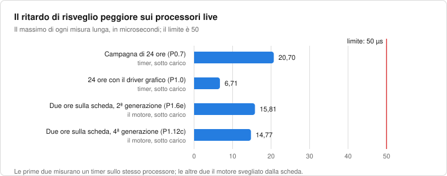
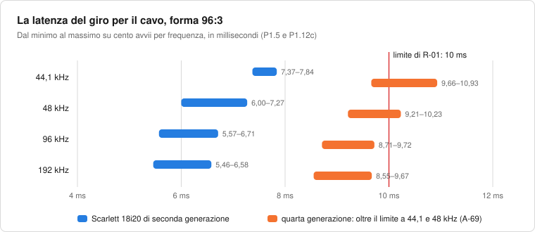
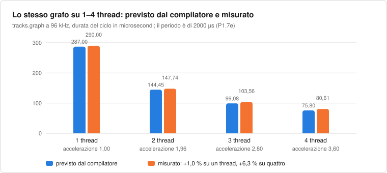

# 4. La storia, passo per passo

Ogni passo ha una voce: che cosa si è fatto, che cosa è venuto fuori, che cosa si è imparato. I numeri sono quelli delle guide dei passi (`docs/fasi/`), dove stanno anche i comandi e i file delle misure; qui sono tutti _(verificati)_ salvo dove è scritto altro. Gli errori sono accennati qui e raccolti nel [capitolo 5](05-errori-e-stime.md).

Le sigle dei passi: `P0.n` è la Fase 0, `P1.n` la Fase 1; una lettera in fondo (`P1.7c`) è un sottopasso, chiuso e misurato per conto suo.

## I passi in una tabella

| Passo | Quando | Dove | In una riga |
| --- | --- | --- | --- |
| P0.1 | 13 novembre | PC | L'ambiente per costruire l'immagine |
| P0.2 | 13 novembre | PC | La prima immagine che parte; il rapporto d'avvio |
| P0.3 | 13 novembre | PC | Il kernel real-time e gli strumenti di misura |
| P0.4a | 13 novembre | 285K | L'installazione sulla macchina vera |
| P0.4b | 15 novembre | 285K | Nessun rumore dal firmware; il limite di potenza a 160 W |
| P0.5a–f | 15 novembre | PC e 285K | Radice verificata, avvio firmato, due slot, aggiornamenti |
| P0.6a | 16 novembre | 285K | I profili di avvio; il fair server trovato e spento |
| P0.6b | 16 novembre | 285K | Riposo in C1, frequenza fissa, il prezzo del fair server spento |
| P0.6c | 17 novembre | 285K | I gruppi di controllo, il driver grafico |
| P0.6d | 17 novembre | 285K | Quanto vale un E-core; il disco cifrato |
| P0.6e | 18 novembre | 285K | La configurazione ferma |
| P0.7 | 19 novembre | 285K | 24 ore sotto carico: massimo 20,70 µs |
| P0.8 | 19 novembre | — | La chiusura della Fase 0 |
| P1.0 | 21 novembre | 285K | La coda spiegata: la grafica senza driver. Massimo 6,71 µs |
| P1.1 | 21 novembre | carta | Il progetto del ciclo e della protezione |
| P1.2 | 22 novembre | PC e 285K | Lo scheletro del motore |
| P1.3 | 22 novembre | 285K | Il ciclo e il cane da guardia: blocco visto in 8 ms |
| P1.4 | 22 novembre | 285K | La scheda; tre periodi; il riscaldamento |
| P1.5 | 23 novembre | 285K | La latenza: 5,5–7,8 ms sulla seconda generazione |
| P1.6a–e | 23–24 novembre | 285K | Il registro dei cicli; nessuna chiamata di sistema nel calcolo; due ore senza xrun |
| P1.12a–c | 24–25 novembre | 285K | La quarta generazione: 8,6–10,9 ms |
| P1.7a | 25 novembre | PC | Il grafo sulla carta |
| P1.7b | 25 novembre | 285K | Il bilancio dall'inizio vero del ciclo |
| P1.7c | 25 novembre | 285K | Il grafo nel ciclo: entro mezzo microsecondo dal previsto |
| P1.7d | 25 novembre | 285K | Il carico vero, calibrato |
| P1.7e | 25 novembre | 285K | Lo scambio del grafo: 179 scambi, nessun campione perso |
| P1.7f | 25 novembre | 285K | Il nodo che non ritorna: fuori dal grafo in 16 ms, nessun campione perso altrove |

## La Fase 0: la piattaforma

Dal 13 al 19 novembre 2026. La domanda della fase: **si può avere, su questa macchina, un insieme di processori su cui un thread riparte sempre entro 50 microsecondi?** La risposta è stata sì, con un massimo misurato di 20,70 µs in 24 ore sotto carico, sceso a 6,71 µs dopo una scoperta fatta all'inizio della Fase 1.

### P0.1: l'ambiente di sviluppo

_13 novembre, PC di sviluppo._ Si prepara il PC (Windows con WSL2 e Ubuntu) per costruire l'immagine con Buildroot e avviarla in una macchina virtuale. Lo strumento è `make check-env`, che controlla una cosa per riga e chiude con `RESULT: PASS`.

Che cosa si è imparato: la macchina virtuale ha bisogno di **KVM** (la virtualizzazione fatta dal processore vero), altrimenti il processore è emulato ed è decine di volte più lento. E due numeri che `check-env` leggeva non erano ciò che sembravano: i 954 GiB «liberi» erano la dimensione massima del disco virtuale di WSL, non lo spazio vero; i 7 GiB di memoria erano la metà che WSL prende se non gli si dice altro.

### P0.2: la prima immagine

_13 novembre, PC di sviluppo._ La prima immagine che parte: un caricatore (`systemd-boot`), il kernel, una radice a sola lettura compressa (EROFS), systemd. Nasce il **rapporto d'avvio**, la riga `DAWOS-BOOT-REPORT` che `make qemu-test` aspetta e giudica.

Il sistema è a regime 2,64 secondi dopo l'avvio del kernel con KVM, 13 in emulazione. Provando si trovano due difetti che nessuno aveva chiesto di cercare: un servizio di rete che apriva due porte verso l'esterno, e un gruppo di sistema mancante.

### P0.3: il kernel real-time

_13 novembre, PC di sviluppo._ Il kernel viene compilato con **PREEMPT_RT**, e nell'immagine entrano gli strumenti di misura: `rtla` e `cyclictest`. In macchina virtuale i massimi sono 619 e 489 µs: non sono misure, servono solo a vedere che gli strumenti funzionano.

Il criterio scritto nel progetto («il file `/sys/kernel/realtime` contiene 1») era sbagliato: in questo kernel quel file non esiste. Lo ha mostrato la prova, fallendo. È il primo caso di una regola che tornerà: **un criterio non provato è un'ipotesi**.

### P0.4a: l'installazione sul 285K

_13 novembre, 285K._ Una seconda immagine, da chiavetta, con un installatore che cancella il disco e scrive dawOS. Accesso remoto con SSH a sole chiavi.

È il passo in cui si vede la differenza tra macchina virtuale e hardware: sono servite tre correzioni **che in QEMU non potevano emergere**. Il firmware rifiutava il caricatore non firmato e avviava Windows; lo schermo restava muto perché la console non era tenuta accesa; e il kernel andava in panico all'avvio («Cannot disable locked x2apic») perché gli mancava un'opzione che su hardware vero è obbligatoria.

### P0.4b: il rumore di fondo e il caldo

_15 novembre, 285K._ Si misura ciò che nessuna configurazione di Linux può togliere: il tempo che firmware e hardware rubano ai processori. Lo strumento è `dawos-hwnoise`. Risultato: **nessun buco di un microsecondo o più, nessun SMI**, anche in quattro ore.

La sorpresa è stata termica: nella prima misura il processore è arrivato a **101 °C**. Il radiatore aveva una ventola sola su due (e, si è scoperto dopo, una collegata al connettore sbagliato). Tolta la scheda grafica dedicata, montata la seconda ventola e messo un **limite di potenza a 160 W**, la macchina sta a 83 °C. La curva misurata: circa 35 °C più 0,30 °C per watt.

Che cosa si è imparato: due serie di misure sono andate perse per un riavvio fatto prima di copiarle. Da allora i file si portano sul PC con `make measure-fetch` prima di toccare la macchina.

### P0.5a–f: un sistema che non si rompe

_15 novembre, PC e 285K._ Sei sottopassi che non riguardano l'audio ma ciò che gli sta sotto: un sistema che non può essere modificato per sbaglio e che torna indietro da solo se un aggiornamento va male.

| Sottopasso | Che cosa aggiunge | Come si prova |
| --- | --- | --- |
| P0.5a | Una partizione per lo stato che deve sopravvivere ai riavvii | Il campo `var=state` del rapporto |
| P0.5b | La radice verificata blocco per blocco (dm-verity) | `make qemu-tamper-test`: un byte cambiato, il sistema non parte |
| P0.5c | Kernel e riga di comando in un file firmato (UKI), Secure Boot | Lo stesso, cambiando un byte nel file di avvio |
| P0.5d | Due slot e il conteggio dei tentativi di avvio | `make qemu-ab-test`: tre avvii falliti, si torna alla versione di prima |
| P0.5e | Aggiornamenti firmati, mandati dal PC | `make qemu-update-test`, poi `make remote-update` |
| P0.5f | L'installazione definitiva sul 285K | Tutte le prove sopra, sull'hardware |

Sul 285K il ritorno alla versione precedente dopo tre avvii falliti prende 96 secondi.

Due cose da ricordare. P0.5e è passato **alla terza consegna**: Buildroot non ricostruisce un pacchetto quando gliene si cambiano le opzioni, e l'immagine non conteneva il programma degli aggiornamenti. E in P0.5f tre difetti veri sono stati trovati **leggendo il registro della costruzione**, non dalle prove: tra questi un timer che avrebbe riavviato la macchina ogni giorno alle 4:10. Da lì il campo `timers=none` del rapporto d'avvio.

### P0.6a: i profili e la prima misura sui processori live

_16 novembre, 285K._ Nascono i **profili di avvio** (quali processori a quale dominio) e `dawos-tune`, che all'avvio applica ciò che non si può scrivere nella riga di comando del kernel. Lo strumento nuovo è `dawos-osnoise`.

Senza isolamento un thread sui futuri processori live viene interrotto per 254–438 µs; con il profilo, 7 µs; alla chiusura del passo, **zero**. In mezzo c'è stata una caccia: un'interruzione al secondo su ogni processore live, che veniva dal **fair server** del kernel. Spento.

Qui l'utente sceglie i processori live: 4–7.

### P0.6b: riposo, frequenza e il prezzo del fair server spento

_16 novembre, 285K._ Tre misure.

- **Il fair server spento ha un prezzo** (esperimento E-02, `dawos-starve-test`): con un thread real-time che non cede, un processo normale sullo stesso processore resta fermo 24,09 secondi su 30. Con il fair server acceso, 0,97. Si tiene spento, e il rischio prende il nome **K-04**: la Fase 1 dovrà proteggersi da sola.
- **La frequenza** dei processori live è fissata a 4,6 GHz (`dawos-freq-sweep`).
- **Gli stati di riposo** (esperimento E-01, `dawos-wakeup`): lo stato C1E costa 5,7–6,3 µs in più a ogni risveglio, lo stato C1 0,1–0,3 µs, non riposare affatto 37–38 watt. Si sceglie **C1** (ADR 0009).

### P0.6c: i gruppi di controllo e il driver grafico

_17 novembre, 285K._ Si aggiorna il firmware della scheda madre e si rimisura tutto. Si verificano le regole dei gruppi di controllo (`dawos-cgroup-test`, esperimento E-03) e il driver grafico `xe` (E-04).

Il fatto da ricordare è un errore nostro. I processori non live giravano più piano del dovuto, e per due giorni la colpa è stata data al limite di potenza, a un'impostazione del firmware, al fissare la frequenza: **tutte ipotesi sbagliate**. Era una riga di `dawos-tune`, ereditata dal progetto iniziale, che dava la preferenza «prestazioni» ai soli processori live.

### P0.6d: quanto vale un E-core, e il disco cifrato

_17 novembre, 285K._ Due esperimenti e una scoperta.

- **E-06** (`dawos-dspbench`): su codice audio vettoriale un E-core vale 0,51–0,59 di un processore live, un P-core dell'altro dominio 1,13–1,17. Ne segue che la sessione di riferimento occuperebbe il 64–70 % del dominio anticipativo: la soglia del requisito R-04 per quel dominio passa dal 60 al 75 %.
- **E-05** (`dawos-stream-test`): leggere e scrivere tracce da cartelle cifrate. Con la cifratura fatta dalle code di lavoro del kernel i processori live vedevano ritardi di 57,75 µs, sopra il limite; con le opzioni che la tengono fuori da quelle code, il problema sparisce.
- **A-33**: un risveglio lento dei processori live, che si presentava quando i P-core dell'altro dominio stavano a bassa frequenza. Rimedio: anche quelli a frequenza fissa, al massimo.

### P0.6e: la configurazione ferma

_17–18 novembre, 285K._ Si chiudono i punti aperti e si **ferma la configurazione**: da qui alla campagna non si cambia più nulla.

Viene scritta una regola che vale ancora: tutto ciò che fa riscrivere al kernel il proprio codice (caricare un modulo, accendere una traccia) interrompe **tutti** i processori, anche gli isolati. Caricare i moduli della virtualizzazione costava circa 4200 interruzioni per processore live.

E c'è l'errore più serio della fase: uno strumento stampava gli indirizzi dei risolutori DNS, e uno di quelli conteneva l'indirizzo hardware della scheda di rete. È finito in un commit. Il commit è stato rifatto, ed è nato `tools/check-private.sh`, che da allora controlla ogni file prima che entri nel repository.

### P0.7: la campagna di 24 ore

_18–19 novembre, 285K._ Ventiquattro ore di `rtla timerlat` sui quattro processori live, un campione ogni 250 µs, mentre gli altri venti processori lavorano a fasi.

| Che cosa | Valore |
| --- | --- |
| Campioni | 1 382 299 704 |
| Ritardo medio | 2,03 µs |
| Uno su centomila oltre | 5,75 µs |
| **Massimo** | **20,70 µs** (limite: 50) |
| SMI, interventi termici, interruzioni di periferiche sui processori live | 0, 0, 0 |

Superato. Ma a fine corsa lo script del verdetto ha scritto `FAIL`: non sapeva leggere un conteggio a nove cifre. Il verdetto è stato rifatto dai dati, e il primo conservato accanto.

Restava una **coda**: sei risvegli sopra i 20 µs, tutti nella fase di carico pieno, senza spiegazione.

### P0.8: la chiusura della fase

_19 novembre._ Il rapporto (`docs/misure/fase-0/rapporto.md`) e una decisione che dà forma alla Fase 1: **processori live senza kernel** (ADR 0021). Avendo visto che ogni ingresso nel kernel è un'occasione di ritardo, il motore dovrà entrarci una volta sola per ciclo.

## La Fase 1: il motore

Dal 21 novembre 2026, in corso. La fase ha nove criteri di accettazione; in breve: la latenza del giro sotto 10 ms e ripetibile (1), nessun xrun nella campagna (2), il margine misurato (3), risvegli sotto 50 µs (4), nessuna chiamata di sistema nel calcolo (5), la protezione K-04 nei tempi (6), il grafo su 1–4 processori con scambio senza discontinuità e carico calibrato (7), le decisioni su kernel e driver (8), la chiusura (9).

### P1.0: il raccordo, e la coda spiegata

_21 novembre, 285K._ Prima di cominciare il motore si torna sulla coda della campagna. L'ipotesi di partenza (la frequenza della parte comune del processore) non ha deciso nulla; l'indagine ha trovato altro: **la grafica integrata, accesa dal firmware perché c'era uno schermo collegato, e lasciata senza driver**.

Con il driver `xe` caricato a ogni avvio (ADR 0022), le 24 ore rifatte danno un massimo di **6,71 µs contro 20,70**, e uno su centomila oltre 3,00 µs contro 5,75.

**Figura 4.1.** Il ritardo di risveglio peggiore in quattro misure lunghe. La scoperta di P1.0 lo ha portato da 20,70 a 6,71 µs.

Nello stesso passo: la verifica del firmware a ogni avvio (il campo `firmware=` del rapporto) e la prima prova con la Scarlett, che suona e registra per 23 minuti senza interruzioni mentre il ritardo sui processori live non supera 5,63 µs.

### P1.1: il progetto del ciclo

_21 novembre, solo carta._ Nessun codice: si decide com'è fatto il ciclo. Le due fasi (attesa e calcolo), il bilancio di calcolo con un margine di 150 µs, il **cane da guardia** con i thread di riserva e systemd come seconda linea, chi sveglia i thread (decisione D-26: tutti aspettano la scheda). I tempi della protezione sono fissati qui, prima di misurarli.

Il documento ha una sezione «che cosa non so». Una delle voci (se più thread possano aspettare la stessa scheda con la stessa chiamata) si rivelerà falsa due volte, in P1.4 e in P1.6b.

### P1.2: lo scheletro del motore

_21–22 novembre, PC e 285K._ Il primo `dawos-engine`: tre crate Rust, un thread su un processore live che fa un ciclo ogni 2,67 ms seguendo un timer (la sorgente `null`), senza scheda.

In un minuto: 22 500 cicli, nessun periodo perso, ritardo di risveglio tra 1,35 e 5,38 µs con media 1,55. È lo stesso numero che dava `timerlat` nella Fase 0: il motore, da fermo, non aggiunge nulla.

### P1.3: il ciclo e la protezione

_21–22 novembre, 285K._ Un thread per ogni processore live, il bilancio di calcolo, il cane da guardia. La prova è `dawos-k04-test`: cinque casi con guasti fatti apposta.

Nel caso del nodo che non ritorna: il blocco è visto dopo **8,00 ms**, il processore è libero dopo 8,03, la riserva è al lavoro dopo 10,67. Tutti dentro i limiti. Spostare via il thread bloccato prende 30 µs.

La serie di misure sul margine, invece, non ha dato il numero che cercava, e ha smentito due previsioni. Se n'è ricavato che cosa il margine protegge davvero: non i thread del kernel, ma la consegna dell'audio; e deve essere più lungo del nodo più lungo.

### P1.4: la scheda

_22 novembre, 285K con la Scarlett 18i20 di seconda generazione._ Il motore apre la scheda con ALSA. Nascono gli strumenti che servono ancora oggi: il **tono**, l'**ascolto** con la quota, la **copia** da ingresso a uscita, `dawos-audio-test`, e la scheda di software per la macchina virtuale.

È stato il passo più lungo, dieci parti, quasi tutte diagnosi.

- La prima prova è fallita 0 casi su 5: **il cavo era nell'ingresso sbagliato**.
- Gli xrun a 96 e 192 kHz non erano un difetto del motore: l'interfaccia, dopo un cambio di frequenza, ci mette secondi ad assestarsi (punto aperto A-57). Da qui il giro di assestamento e il **riscaldamento** non giudicato.
- Compaiono gli **slittamenti**: il segnale si sposta di qualche campione senza che nessun contatore lo dica (rischio K-08, punto A-58). Tre ipotesi cadute una dopo l'altra.
- Aspettare la scheda in più thread con la stessa chiamata non funziona: per ora un thread solo (A-56).

Decisioni dell'utente: **tre periodi** nel buffer invece di due, e il primo minuto non giudicato. Accettazione: 30 minuti, nessun xrun e nessuno slittamento dopo il primo minuto.

### P1.5: la latenza

_23 novembre, 285K, seconda generazione._ Si misura il requisito R-01 con due strumenti nuovi: il **conteggio** (ogni campione porta il suo numero: giro dentro l'interfaccia, esatto al campione) e le **raffiche** (rumore riconosciuto per correlazione: giro per il cavo, convertitori compresi).

La forma del buffer scelta è **`96:3`** (decisione D-14): periodi da 2 ms, tre nel buffer. Su cento avvii per frequenza:

| Frequenza | Giro per il cavo |
| --- | --- |
| 44,1 kHz | 7,37–7,84 ms |
| 48 kHz | 6,00–7,27 ms |
| 96 kHz | 5,57–6,71 ms |
| 192 kHz | 5,46–6,58 ms |

R-01 rispettato. Due cose imparate: **due periodi non reggono** con nessuna lunghezza (con `64:2` metà dei campioni torna fuori posto senza un solo xrun segnalato); e il giro **non è lo stesso a ogni avvio** dei flussi (A-59).

### P1.6a: il registro di ogni ciclo

_23 novembre, 285K._ Ogni thread scrive una riga da 64 byte per ciclo in un anello senza lucchetti; un thread non real-time le legge. Costo: non misurabile. Record persi: nessuno su quasi un milione di cicli.

Con il registro si chiude subito un mistero di P1.5, i «periodi saltati senza xrun» (A-61): **non era il thread, era la scheda**. Il driver riceve l'audio a blocchi di un millisecondo, e ogni 155,2 secondi il confine del periodo scivola di un blocco, perché l'orologio dell'interfaccia e quello del bus USB differiscono di 6,44 parti per milione.

### P1.6b: tutti i thread sulla scheda

_23 novembre, 285K._ Gli altri thread live devono svegliarsi insieme a quello che tiene la scheda. Il primo tentativo (tutti in attesa sullo stesso flusso) fallisce: chi segue prende 13 000 cicli su 30 035. Il secondo funziona: ognuno dorme su un **timer che il kernel lega al flusso della scheda**, e prende il numero del ciclo da ciò che il primo pubblica in memoria.

Risveglio medio 7,6–7,8 µs, massimo 14,49; meno di un microsecondo tra il primo thread sveglio e l'ultimo.

### P1.6c: chi entra nel kernel

_24 novembre, 285K._ Il motore impara ad accendere una traccia del kernel sui propri processori e ad assegnare ogni evento a una fase del ciclo (`--kernel-entries`).

- **Zero chiamate di sistema nella fase di calcolo in 2 400 654 cicli**, e due per ciclo fuori: il criterio 5, per la prima volta misurato.
- Il punto A-55 (perché con quattro thread il risveglio è 7,5 µs e non 3) ha un nome: il thread dell'interruzione USB tiene un lucchetto del flusso proprio nell'istante in cui il thread live lo chiede. Spiegato e accettato.
- I timer dei thread live venivano spostati su un altro processore: con `kernel.timer_migration=0` i risvegli lenti spariscono.

### P1.6d: far rispettare la regola

_24 novembre, 285K._ Da «non abbiamo visto chiamate di sistema nel calcolo» a «se ce n'è una, viene fermata»: **Syscall User Dispatch**. La prova: 24 025 chiamate fatte apposta, 24 025 fermate, riconosciute ed eseguite, senza un xrun. Ognuna costa 1,2 µs; quando nessuno chiama, il meccanismo non costa nulla di misurabile.

### P1.6e: il margine e le due ore

_24 novembre, 285K._ La serie sul margine, rifatta con la scheda: al 120 % di carico **nessun xrun con nessun margine da 400 a 50 µs**. La previsione diceva xrun da 150 µs in giù. Il margine resta 150 µs, e si sa che lo decide la durata dei nodi, non la scheda.

Poi due ore sotto il carico della campagna: 14,4 milioni di cicli, **nessun xrun, nessuno slittamento, nessuna chiamata di sistema nel calcolo**, risveglio peggiore 15,81 µs. Ciò che ancora entra nei processori live sono 72 chiamate da altri processori all'ora (`do_sync_core`), meno di 2 µs l'una.

### P1.12a–c: la Scarlett di quarta generazione

_24–25 novembre, 285K._ Arriva l'interfaccia nuova e il passo, previsto per dopo, viene anticipato.

- **P1.12a**: la quarta generazione si comanda con un programma, `fcp-server`, che entra nell'immagine con il firmware. Aggiornato il firmware, i controlli passano da 693 a 959: per il motore è quasi un'altra scheda.
- **P1.12b**: i file dello «stato noto» e l'anello di prova dentro l'interfaccia. La prima prova: 0 su 8, due volte. Di nuovo il cavo.
- **P1.12c**: latenza e due ore, rifatte.

| Frequenza | Giro per il cavo, quarta generazione | R-01 |
| --- | --- | --- |
| 44,1 kHz | 9,66–10,93 ms | no |
| 48 kHz | 9,21–10,23 ms | no |
| 96 kHz | 8,71–9,72 ms | sì |
| 192 kHz | 8,55–9,67 ms | sì |

**Figura 4.2.** La latenza del giro per il cavo sulle due interfacce. La quarta generazione supera il limite a 44,1 e 48 kHz.

Il giro è 3,1 ms più lungo che sulla seconda generazione, e **R-01 non è rispettato a 44,1 e 48 kHz** (punto aperto A-69, rinviato al passo sul driver). La regola trovata: giro = buffer + una costante del driver, 3,4–3,7 ms qui contro 0,4–0,5 là.

Le due ore passano senza xrun né slittamenti. Ma lo strumento contava 44 «risvegli da 50 µs in su» che non erano risvegli: undici volte all'ora il driver annuncia un periodo un millisecondo prima del solito, mentre i thread stanno ancora calcolando (A-68). Da qui parte P1.7b.

La quarta generazione diventa l'interfaccia del resto della fase.

### P1.7a: il grafo sulla carta

_25 novembre, PC._ Il grafo fuori dal tempo reale: il formato del file, i controlli, la compilazione, l'assegnazione di ogni nodo a un thread (decisione D-10: **statica**, ADR 0025). Il comando `dawos-engine graph FILE` stampa ciò che il compilatore prevede.

Due cose imparate scrivendolo: assegnare nodo per nodo sparpaglia le tracce tra i processori per un guadagno sulla carta del 3 %, quindi si assegna **per segmenti**; e usare tutti i thread può allungare il ciclo, quindi il compilatore prova con uno, con due, e tiene il programma più corto.

### P1.7b: il bilancio dall'inizio vero del ciclo

_25 novembre, 285K._ La conseguenza di A-68. Il bilancio di calcolo si conta dall'**inizio vero** del ciclo, non dall'istante in cui il periodo era annunciato; e i cicli **partiti indietro** si contano a parte dai risvegli.

Scrivendo la prova è venuto fuori che la regola decisa era incompleta: un thread in sovraccarico sarebbe rimasto ogni ciclo un po' più indietro, fino a mangiarsi tutta la riserva del buffer. È stato aggiunto un terzo limite (mezzo periodo dopo la fine del proprio periodo).

All'85 % di carico, dopo uno scatto anticipato: nessun ciclo tagliato (con la regola vecchia uno), tre cicli partiti indietro, nessun «risveglio tardivo» finto.

### P1.7c: il grafo nel ciclo

_25 novembre, 285K._ I thread eseguono davvero i nodi, aspettandosi con l'**attesa attiva**; buffer e stato dei nodi dietro lucchetti solo tentati; i campioni in virgola mobile.

- Il caso `relay`: il conteggio passato da un thread all'altro attraverso quattro thread per tre minuti. **8 640 172 campioni al loro posto, nessuno fuori posto.**
- Lo stesso grafo su 1, 2, 3 e 4 thread: 289,38, 147,13, 101,41 e 77,59 µs, contro 290,16, 147,10, 100,96 e 77,95 previsti dal compilatore. **Entro mezzo microsecondo**; accelerazione 3,73 su quattro.
- Le attese tra thread durano meno di un microsecondo.

In questo passo i nodi di carico non calcolano: aspettano il tempo che dichiarano. Dice quindi quanto costa il grafo in sé, non il calcolo.

### P1.7d: il carico vero

_25 novembre, 285K._ Il carico di riferimento diventa calcolo vero: cascate di filtri passa-tutto in AVX2, calibrate sul 285K. Arrivano i bit FTZ e DAZ, il tempo misurato di ogni nodo, e lo strumento `tools/graph-calibrate.sh`.

| Che cosa | Misurato |
| --- | --- |
| Parte fissa, uno stadio, un ritocco | 1,922, 1,845 e 0,207 ns per frame |
| Le tre classi a 96 kHz, ricostruite | 10,3, 40,7 e 150,3 ns per frame (obiettivo 10, 40, 150) |
| Lo stesso tipo di filtro in C (`dawos-dspbench`) | 1,622 ns per stadio |
| Un carico alimentato con numeri denormalizzati | 9,9 ns per frame con FTZ e DAZ, 691 senza |
| `tracks.graph` su 1–4 thread | 289,87, 149,63, 103,17 e 79,67 µs; accelerazione 3,64 |

Due cose non previste: lo stadio costa il **14 % più** del nucleo in C (c'è una copia tra registri in più nella catena), e il costo per frame **dipende dalla lunghezza del blocco** (1,66 ns a 96 frame, 1,95 a 384). Tutte e due nel punto aperto A-71.

Lungo la strada: l'immagine compilava il motore con un livello di ottimizzazione diverso da quello scritto nei sorgenti (corretto, con una decisione dell'utente); e una volta, nella macchina virtuale dell'utente, i thread del motore non sono partiti in tempo, senza che si sia capito perché (A-70).

### P1.7e: un grafo al posto di un altro

_25 novembre, 285K._ Lo scambio del grafo mentre il ciclo gira. Due «posti» per un grafo; quello nuovo si costruisce nel posto libero, fuori dal tempo reale; si nomina un ciclo tre periodi più avanti, e da quel ciclo tutti i thread eseguono il nuovo. Decisioni dell'utente: lo stato passa **per nome del nodo**, e lo scambio per ora lo chiede **la riga di comando**, per le prove.

La prova è il caso `swap`: il conteggio attraverso due grafi che si scambiano ogni secondo, con una linea di ritardo che deve conservare il suo contenuto da un grafo all'altro. Se uno scambio perde o inventa anche un solo campione, il conteggio lo dice.

| Che cosa | Misurato | Atteso, scritto prima |
| --- | --- | --- |
| Scambi in tre minuti | 179 | Circa 180 |
| Giro del conteggio | 1012 campioni | 1012: i 916 di `relay` più i 96 della linea di ritardo |
| Campioni al loro posto | 8 642 668, **nessuno fuori posto** | Nessuno fuori posto |
| Costruire un grafo nuovo | 20 µs in media | 100–200 µs |
| Dall'offerta a tutti i thread sul grafo nuovo | 5,4 ms | Circa 6 ms |

**Figura 4.3.** Lo stesso grafo su 1–4 thread, con i costi misurati scritti nei sorgenti: la previsione regge su un thread e si allarga con il numero dei thread.

Lo scambio fa ciò che deve. Ma la prova audio ha dato **dieci casi su undici**: in un caso che non c'entra con il grafo la scheda ha rifiutato una volta un periodo in uscita, una **scrittura corta**. Cercando nei file della giornata ne sono saltate fuori altre due, in righe che la prova non giudicava e che nessuno aveva guardato. Tutte e tre sembrano cadere all'avvio dei flussi _(ipotesi)_: è il punto aperto A-72.

Decisioni dell'utente: le scritture corte del riscaldamento si contano a parte, come gli xrun; il motore annota quando capita la prima; la prova audio si rifà, e il passo si chiude con quella.

La seconda misura: undici casi su undici, lo scambio identico alla prima (1012 campioni, 8 642 764 al loro posto, nessuno fuori posto). E una scrittura corta, in un altro caso, questa volta con lo strumento acceso: **al periodo 1 dopo l'avvio dei flussi, a un millisecondo dall'inizio, zero frame presi su 96**. È ciò che l'ipotesi diceva. In tutta la giornata, quattro su 52 avvii a 48 kHz. Il perché è del passo sul driver.

### P1.7f: il nodo che non ritorna

_25 novembre, 285K._ La protezione K-04 incontra il grafo. Un nodo che smette di ritornare viene **abbandonato** dal cane da guardia: silenzio da subito per chi lo aspettava. Poi il motore toglie il nodo dalla descrizione, ricompila e scambia: il nodo sparisce.

Il problema vero del passo è ciò che il thread bloccato **si tiene**: lo stato del nodo, i buffer su cui lavorava, e il grafo intero. Nessuno dei tre gli si può togliere. Le risposte: il nodo non lo chiede più nessuno; i buffer diventano silenzio per chi li legge; e il grafo si tiene con un riferimento contato, così il thread bloccato si porta via il suo senza fermare gli scambi degli altri.

La prova è un nodo fatto apposta, la **trappola** (`trap`), che dopo dodici secondi non ritorna più. Sta su un thread; il conteggio passa da altri due. | Che cosa | Misurato | Atteso, scritto prima | Limite |
| --- | --- | --- | --- |
| Il cane da guardia se ne accorge | 6,97 ms | 6,0–8,5 ms | 8,5 ms |
| La riserva è al lavoro | 8,00 ms | Entro 12 ms | 50 ms |
| Il grafo senza il nodo è in uso | **16,14 ms** | 16–27 ms | 500 ms |
| Campioni del conteggio | 1 823 402 al loro posto, **nessuno fuori posto** | Nessuno fuori posto | — |

Un nodo che muore su un thread non è costato un campione a ciò che girava sugli altri, e non c'è stato un xrun.

Il primo giro si è fermato alla macchina virtuale dell'utente, quella sera molto più lenta del solito: la trappola, che contava i cicli e non il tempo, non è mai scattata (corretto), e un thread del motore non è partito in tempo, per la seconda volta in un giorno (A-70: ora, dove il tempo non è tenuto, ha tre secondi in più e il rapporto dice di quanto ha tardato).

Scrivendo il passo è caduta una frase del progetto di P1.1: la «dissolvenza» verso il silenzio. Non si può sfumare un suono che manca già da tre periodi.

### P1.7g: l'accettazione del grafo

_25 e 26 novembre: superato, con l'ora di scambio fatta due volte._ Il criterio 7 chiede tre cose: lo stesso grafo su 1–4 processori con accelerazione e percorso critico misurati, lo scambio senza discontinuità, il carico calibrato. Sono già state misurate tutte, ma ognuna in un passo e con un'immagine diversa. Qui si rifanno sulla stessa immagine, senza toccare il motore, e uno script ne ricava un verdetto.

Decisioni dell'utente: solo l'accettazione, senza codice nuovo; e lo scambio per **un'ora**, sotto il carico della campagna, come le altre accettazioni. Le soglie sono scritte prima della misura.

Ciò che non si sapeva prevedere, ed era scritto: quante volte, in un'ora di scambi, liberare la memoria di un grafo vecchio manda un'interruzione ai processori live. La traccia del kernel non aveva mai guardato uno scambio.

La prima misura: tutte le soglie rispettate. Le tre classi entro lo 0,5 %; il grafo a 96 kHz su quattro thread al 7,2 % dal previsto, accelerazione 3,56; nell'ora 3659 scambi e **351 361 864 campioni al loro posto, nessuno fuori posto**. E la risposta alla domanda aperta: dodici ingressi nel kernel durante il calcolo, tutti per svuotare la TLB, in due soli istanti, subito dopo uno scambio. Non migliaia; ma nemmeno zero, ed è il punto aperto A-75.

L'ora però è cominciata due minuti prima del carico della campagna, che era già finita ed è stata rilanciata. L'utente ha deciso di rifarla. Lo strumento stampava «la campagna non girava all'inizio» senza giudicarlo: ora lo giudica, e può rifiutarsi di partire.

La seconda ora, il 26 novembre, sotto il carico dall'inizio alla fine: 3659 scambi, **351 362 246 campioni al loro posto, nessuno fuori posto**, nessun xrun, risveglio peggiore 14,85 µs. **Il criterio 7 è raggiunto**, e con lui il passo P1.7 è chiuso.

| | Prima ora | Seconda ora |
| --- | --- | --- |
| Campagna all'inizio | non girava | girava |
| Traffico di rete, per senso | 4,5 GB | 95 GB |
| Giro del conteggio | 1912 campioni | 1914 |
| Campioni fuori posto | 0 | 0 |
| Pulizie della TLB nel calcolo, per processore live | 3 | 3 |
| Pulizie del predittore (`__bpf_arch_ibpb`), per processore live | 10 | 38 |

Tre cose che il confronto ha insegnato.

- **Il giro non è una costante.** 1912 in un'ora, 1914 nell'altra, fermo dall'inizio alla fine di ognuna: dipende da come partono i due flussi della scheda. Avevo scritto «previsione sbagliata» per due campioni che sono solo un altro avvio.
- **Le pulizie della TLB sono tre per processore in tutte e due le ore**, con un carico intorno venti volte diverso sulla rete. Non è il caso: è qualcosa che il processo fa a un punto fisso della sua corsa. Quando, nella seconda ora, non si sa: il rapporto elenca solo le prime dodici righe, ed erano di un altro tipo (A-75).
- **Uno degli ingressi nel kernel ha finalmente una causa.** `__bpf_arch_ibpb` è la pulizia del predittore dei salti che il kernel fa su tutti i processori quando carica un programma BPF classico; e a caricarli, qui, è con ogni probabilità il server SSH a ogni connessione. Le connessioni le fanno i nostri strumenti di misura: più traffico di rete, più pulizie (A-76).

### P1.8a: dove stanno i tre millisecondi

_26 novembre: misurato._ Sulla Scarlett di quarta generazione il giro per il cavo è 10,2 ms a 48 kHz, due decimi sopra il limite, e sotto il buffer ci sono 3,5 ms che nessuna forma provata ha toccato. Il passo P1.8 è quello del driver, e l'utente ha scelto di cominciare da qui: capire dove stanno.

Il sorgente del driver dice due cose. La prima era nota: con un'interfaccia a retroazione implicita la modalità a bassa latenza è esclusa, e i campioni vengono copiati in un blocco USB quando il blocco si prepara, non quando parte. La seconda no: **la lunghezza dei blocchi dipende dal periodo che il motore chiede**. Con il periodo di 2 ms usato finora sono blocchi da un millisecondo, in entrata e in uscita; con un periodo di un quarto di millisecondo sono un pacchetto solo, 125 µs.

Tutte le forme provate fin qui avevano periodi di un millisecondo o più: per questo la «costante» sembrava non dipendere dalla forma.

Nel motore è entrata un'opzione sola, `--slices`: il driver riceve un periodo più corto, il motore si sveglia una volta per ciclo come prima. Per ora con un thread, perché gli altri si sveglierebbero a ogni periodo del driver.

Il primo giro si è fermato, ancora una volta, alla macchina virtuale dell'utente; ma non per il codice nuovo. È fallito il caso più vecchio di tutti: il thread che tiene la scheda stava recuperando un xrun quando il giro è finito, e il motore lo ha preso per bloccato. Una corsa che c'era dal passo P1.4 e che serve una macchina molto lenta per vedere.

La previsione, scritta prima: con otto fette il giro si accorcia tra 0,9 e 1,75 ms, e a 48 kHz scende sotto i 10 ms; a 44,1 è al limite. Se non si accorcia, i tre millisecondi sono dell'interfaccia e questa strada è chiusa.

La misura ha dato una terza risposta, che non avevo messo in conto.

| Fette | Giro per il cavo a 48 kHz, al massimo | Che cosa succede |
| --- | --- | --- |
| 1 (com'era) | 10,23 ms | — |
| 2 | 10,21 | Quasi nulla; ogni tanto un avvio mezzo millisecondo più corto |
| 4 | **9,73** | Mezzo millisecondo in meno a tutte le frequenze, pulito in due minuti |
| 8 | — | Il bus porta due pacchetti su tre: il ciclo dura 3 ms invece di 2, metà dei campioni fuori posto, e ALSA non conta un xrun |

Il modello era sbagliato: avevo ragionato come se un campione aspettasse «un trasferimento» in entrata e uno in uscita. Ma l'uscita insegue l'ingresso trasferimento per trasferimento, e la distanza tra i due flussi sul cavo si decide **all'avvio**: la lunghezza del trasferimento conta solo per come l'avvio va. Nel sorgente del controller USB c'è un candidato per una parte dei tre millisecondi: un flusso che parte a coda vuota è messo in programma da 1,25 a 2,25 ms più avanti.

E lo strumento ha mancato il dato che chiamavo «il più sicuro», i pacchetti per trasferimento letti sul bus: usava un comando, `timeout`, che nell'immagine non c'è.

### P1.8b: leggere il bus

_26 novembre: consegnato, in attesa della misura._ Tre millisecondi restano senza padrone, e stanno in un posto dove il motore non guarda: il bus. L'utente ha scelto di guardarci prima di investire nelle quattro fette.

Il kernel mostra ogni trasferimento USB due volte, quando il driver lo consegna al controller e quando torna, con l'istante di ognuna. Dalla differenza si ricava con che anticipo sul cavo l'uscita viene consegnata: il numero che il sorgente del controller fa sospettare grande.

La domanda conta per un'altra decisione: se quel tempo sta nel driver del controller USB, un driver audio nostro non lo toccherebbe.

Questa volta lo strumento è stato provato prima di consegnarlo, su un bus vero: una scheda audio USB emulata nella macchina virtuale.

### Che cosa viene dopo

| Passo | Che cosa |
| --- | --- |
| P1.8 | Il driver della scheda: dopo la misura di P1.8a, i thread con il periodo corto e la prova sotto carico, la consegna senza chiamata di sistema, la seconda generazione, l'avvio (A-72), la decisione su un driver nostro |
| P1.9 | Il kernel: le chiamate tra processori che restano (A-49), comprese quelle che provoca il processo stesso (A-75) e quelle dei filtri BPF (A-76) |
| P1.10 | La campagna della Fase 1 |
| P1.11 | La chiusura |
