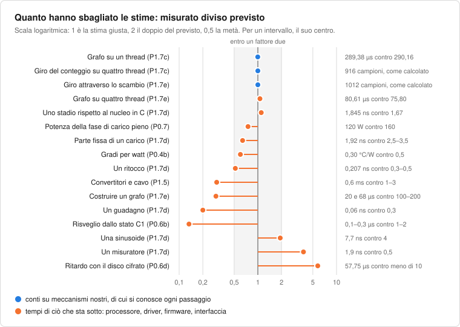

# 5. Errori e stime sbagliate

In questo progetto una previsione si scrive **prima** della misura. Quando la misura la smentisce, la smentita resta scritta nella guida del passo. Questo capitolo le raccoglie, insieme agli errori di strumento, di metodo e di consegna.

Non è un elenco di colpe. Serve a tre cose: a sapere **quanto fidarsi di una stima** fatta allo stesso modo la prossima volta; a riconoscere un errore già fatto quando si ripresenta con un altro vestito; e a ricordare che un numero «ragionevole» non è un numero misurato.

Chi ha sbagliato è quasi sempre chi scrive le guide e il codice, cioè l'assistente che fa da architetto del progetto; dove l'errore è di procedura sulla macchina, è detto.

## Previsioni smentite dalla misura

Ciò che era stato scritto come attesa, e ciò che è stato misurato sul 285K.

| Passo | Che cosa si prevedeva | Che cosa si è misurato | Perché, se si sa |
| --- | --- | --- | --- |
| P0.4b | Il processore sale di 0,5 °C per watt | 0,30 °C per watt, ma partendo da 35 °C | Il liquido era già caldo a riposo: il problema era il punto di partenza, non la pendenza |
| P0.4b | A riposo consuma 20 W, e il contatore del processore sottostima del 10 % | 3,7 W, e il contatore concorda con la presa | Stima fatta senza un dato |
| P0.6b | Lo stato di riposo C1 costa 1–2 µs a ogni risveglio | 0,1–0,3 µs | Stima pessimista |
| P0.6d | Un E-core perde di più quando lavorano quattro flussi insieme | Il rapporto con un P-core è lo stesso | — |
| P0.6d | Scrivere «con conferma» su disco costa 0,2–3 ms | Quasi 5 ms | — |
| P0.6d | La cifratura del disco non tocca i processori live (sotto 10 µs) | 57,75 µs | La cifratura passava per le code di lavoro del kernel; con le opzioni che la tengono fuori da quelle code il ritardo sparisce |
| P0.7 | La fase di carico pieno porta il processore a 160 W | Si assesta a 120 W | Il carico misto non è tutto calcolo. È stata aggiunta una fase di solo calcolo |
| P1.3 | Stringendo il margine, i thread del kernel aspettano di più | Non cambia | Chi sfora dorme comunque fino al periodo dopo: il margine protegge la consegna dell'audio, non il kernel |
| P1.4 | Svegliarsi sulla scheda costa «decine» di microsecondi | 3 µs in media, meno di 9 al massimo | — |
| P1.5 | USB e convertitori aggiungono 1–3 ms al giro | Al limite basso o sotto; convertitori e cavo, da soli, 0,6 ms a 48 kHz | — |
| P1.6b | Con il timer della scheda il primo thread torna a 3 µs di risveglio | Resta a 7,5–7,7 µs | Il ritardo veniva da un lucchetto del kernel, non dal modo di aspettare (A-55) |
| P1.6e | Al 120 % di carico, xrun con margini da 150 µs in giù | **Nessun xrun con nessun margine**, da 400 a 50 µs | Non si sa: la scadenza vera della consegna è più lontana di quanto calcolato. Rinviato al passo sul driver |
| P1.12c | Nessuna previsione scritta: si dava per inteso che la latenza fosse quella della seconda generazione | 3,1 ms in più: R-01 non rispettato a 44,1 e 48 kHz | Con la retroazione implicita il driver esclude la sua modalità a bassa latenza. L'indizio c'era già in P1.4, e andava detto prima |
| P1.12c | Con `64:3` il ciclo dura 1,33 ms | I periodi arrivano a 1, 1 e 2 ms | Il driver annuncia l'audio solo a blocchi di un millisecondo |
| P1.7c | Il ciclo vero dura 5–40 µs più del programma del compilatore | Entro 0,5 µs | I thread si svegliano a mezzo microsecondo l'uno dall'altro: lo scarto atteso non c'è |
| P1.7c | Il thread della scheda aspetta gli altri due volte per ciclo | Mai | Arriva ai nodi che aspettano quando gli altri hanno già finito |
| P1.7d | Il filtro in Rust dà lo stesso codice macchina di quello in C | Uno stadio costa il 14 % in più | Una copia tra registri dentro la catena di dipendenza: nove cicli di clock invece di otto (A-71) |
| P1.7d | La parte fissa di un carico costa 2,5–3,5 ns per frame, un ritocco 0,3–0,5 | 1,92 e 0,207 | Stime ricavate dal rapporto di velocità tra l'ambiente di sviluppo e il 285K: quel rapporto non è lo stesso per ogni tipo di codice |
| P1.7d | Il costo per frame è lo stesso a tutte le frequenze, entro decimi di nanosecondo | Da −9 % a +6 %: 1,66 ns a 96 frame, 1,95 a 384 | Con blocchi corti il processore sovrappone passate consecutive _(ipotesi)_ |
| P1.7d | Un guadagno costa 0,3 ns per frame, una sinusoide 4, un misuratore 0,5 | 0,06, 7,7 e 1,9 | Stime a occhio, fatte quando i nodi non calcolavano ancora |
| P1.7d | A vuoto, con il motore compilato a ottimizzazione 3, il ciclo costa uguale «o poco meno» | Poco di più: 3,27, 4,89 e 6,09 µs contro 3,17, 4,43 e 5,89 | Insieme all'ottimizzazione sono arrivati i controlli di overflow, che costano qualcosa _(ipotesi)_ |
| P1.7e | Leggere, compilare e costruire un grafo di 17 nodi costa 100–200 µs | 20 µs in media e 55 al massimo nella prima misura, 68 e 299 nella seconda | La stima veniva dall'ambiente di sviluppo. La seconda misura dice anche che una misura sola non bastava per chiamarla sbagliata: c'è di mezzo la lettura di un file |
| P1.7e | Con i costi misurati scritti nei sorgenti, il ciclo vero sta entro il 3 % del programma del compilatore | +1,0 % su un thread, +6,3 % su quattro | I costi sono misurati su un thread solo: un bus che legge dodici ingressi scritti da altri thread costa 1,72 µs e non 0,50 |
| P1.7g | A 192 kHz il grafo su quattro thread dura tra l'8 e il 14 % più del previsto | +6,5 % | Avevo sommato due scarti come se fossero indipendenti: con blocchi lunghi ciò che non scala con i frame (attese, passaggi tra thread) pesa meno |
| P1.7g | «Non so»: liberare un grafo a ogni scambio può svuotare la TLB sui processori live, forse migliaia di volte in un'ora | 12 volte, in due soli scambi su 3659; nella seconda ora di nuovo 12 | Non è lo scambio. Lo stesso numero in due ore diverse dice che non è nemmeno il caso: è qualcosa che il processo fa a un punto fisso della corsa _(ipotesi)_. Dire «non so» prima della misura è servito: la riga da guardare era già scritta |
| P1.8e | Con l'interruttore spento un trasferimento d'uscita resta presso il controller tra 2980 e 3005 µs; sotto carico la consegna più tarda perde tra 40 e 100 µs | Due gruppi a 30 µs di distanza (2945–3010), anche a macchina ferma; la consegna più tarda perde 25–45 µs | Avevo guardato 120 righe di una lettura, e lì c'era un gruppo solo: un campione piccolo mostra un modo, non quanti ce ne sono. Sul ritardo avevo di nuovo ecceduto in prudenza, senza una misura |
| P1.8d | Sotto il carico della campagna la patch lascia da uno a cinque slittamenti del conteggio in un'ora, e il giro alla fine è più lungo: verdetto `FAIL` | Nessuno slittamento, giro 729 campioni all'inizio e alla fine, `PASS`; poi cento avvii per frequenza tutti sotto i 10 ms | Avevo preso un decimo di millisecondo per tutto il tempo disponibile e dato per certo un ritardo che non avevo misurato. Il rischio era vero come domanda, non come previsione: senza una misura dei ritardi del kernel sotto carico, il numero giusto da scrivere era «non lo so» |
| P1.8c | Con i trasferimenti consegnati «appena possibile», l'uscita resta presso il controller tra 1,5 e 1,8 ms | 1,10 ms: la durata del trasferimento più un decimo | Sbagliata per prudenza: avevo preso per anticipo il mezzo millisecondo che il controller dichiara. Il guadagno è più grande, e il margine più stretto, di quanto avevo scritto |
| P1.8b | Con quattro fette il tempo dell'uscita presso il controller cala di 1,25 ms, oppure di 0,75 | Di 0,53: la durata del trasferimento scende di 0,75 e l'anticipo sale di 0,2 | Avevo messo due alternative e nessuna era giusta: non avevo letto fino in fondo la regola con cui il controller sceglie il frame di partenza, che con trasferimenti corti fa comandare il punto peggiore del millisecondo |
| P1.8a | Con un periodo del driver otto volte più corto il giro si accorcia tra 0,9 e 1,75 ms (tra 0,75 e 1,5 con quattro) | Con quattro: 0,5 ms. Con otto il flusso si rompe: il bus porta due pacchetti su tre | Avevo supposto che un campione aspettasse un trasferimento in entrata e uno in uscita. L'uscita insegue l'ingresso, e la distanza tra i due si decide all'avvio: la durata del trasferimento non entra nel conto in proporzione |
| P1.7g | Il giro del conteggio a 96 kHz è 1914 campioni | 1912 nella prima ora, 1914 nella seconda | Il conto era giusto; sbagliato era crederlo una costante. Si sposta di un paio di campioni da un avvio dei flussi all'altro, e io avevo già registrato i 1912 come previsione smentita |

**Figura 5.1.** Misurato diviso previsto, per le stime che avevano un numero. I conti sui meccanismi nostri stanno sull'uno; gli altri vanno da un settimo a quasi sei volte il previsto.

**Che cosa dice questa tabella.** Le stime sbagliano in tutte e due le direzioni, e non di poco: un fattore due o tre è normale, un fattore dieci capita. Sbagliano di più dove non c'era un dato vicino (i costi dei nodi «a occhio») e di meno dove si partiva da una misura (i tempi del grafo in P1.7a, giusti alla cifra). Nessuna di queste stime è stata usata per decidere: per questo sbagliarle è costato poco.

## Diagnosi partite dall'ipotesi sbagliata

Qui non c'era una previsione ma un difetto da spiegare. In quasi tutti i casi la prima spiegazione era sbagliata, e spesso anche la seconda.

**Il «salto» di 21 °C (P0.4b).** La temperatura passava da 70 a 91 °C in una sola lettura. Tre ipotesi: la pompa, una potenza che il contatore non vedeva, la regolazione delle ventole. Era **il metodo di misura**: le letture «fredde» cadevano nella pausa che tutti i thread di misura facevano insieme.

**Un'interruzione al secondo sui processori live (P0.6a).** Il colpevole era giusto (il kernel che tutela i processi normali), il percorso no: non era la contabilità aggiornata da un altro processore, era il timer del _fair server_.

**I processori non live più lenti del dovuto (P0.6b, P0.6c).** Ipotesi cadute: il limite di potenza, un'impostazione del firmware, il fissare la frequenza, un raggruppamento delle preferenze energetiche. Una delle prove era sbagliata due volte, perché riscriveva il valore che c'era già. Causa: **una riga nostra** in `dawos-tune`.

**Il risveglio lento dei processori live (A-33, P0.6d).** Prima ipotesi: il processore si ferma. No, si sveglia tardi. Seconda: lo provocano gli E-core. No, i P-core. Terza: conta che il P-core vicino salga sopra la frequenza dei live. Sbagliata **nel verso**: conta che stia in basso.

**La coda a 18–20 µs della campagna (P0.7, P0.8, P1.0).** È la diagnosi più lunga del progetto. Ipotesi cadute, nell'ordine: la versione del kernel, la vicinanza all'avvio, i blocchi del bus della memoria, la frequenza della parte comune del processore, il contatore di energia della grafica come «firma», il cambio di frequenza della memoria. Causa: la grafica integrata accesa dal firmware e lasciata senza driver. Per quale meccanismo disturbi i processori **non si sa ancora**; si sa che con il driver caricato non succede.

**Gli xrun a 96 e 192 kHz (P1.4).** Ipotesi: il driver svuota il buffer in anticipo. Era l'interfaccia che si assesta dopo un cambio di frequenza: per qualche secondo dà zero campioni, poi silenzio, poi il segnale.

**Gli slittamenti senza xrun (P1.4).** Ipotesi cadute: manca riserva sul bus USB (tre periodi non li tolgono); la retroazione esplicita (con l'altra restano). E un errore di metodo: «due al minuto a ritmo costante» veniva dal guardare solo giri da un minuto. Con giri da dieci minuti, 19 slittamenti su 26 cadono nei primi quindici secondi.

**I periodi «saltati» senza xrun (A-61, P1.5 e P1.6a).** Sembrava un ritardo del thread. Il registro dei cicli ha mostrato il thread in attesa e la scheda in ritardo di un millisecondo: lo scatto del confine del periodo.

**Tre slittamenti letti al contrario (P1.6a).** Il tono li mostrava come +30 e −29 campioni, «un millisecondo avanti e indietro». Il conteggio ha detto +29, +30 e +35, tutti nello stesso verso: il tono vede gli spostamenti **modulo 64 campioni**, e non distingue +35 da −29.

**Il risveglio a 7,5 µs con quattro thread (A-55, P1.6c).** L'ipotesi (un lucchetto del kernel conteso) era giusta, ma la traccia che doveva dimostrarla no: ci si aspettava di vedere il thread perdere il processore. Nel kernel real-time chi aspetta un lucchetto tenuto da un thread che sta girando **aspetta girando**, e il processore non lo perde.

**I 44 risvegli tardivi (P1.12c).** Non erano risvegli: undici cicli, su quattro thread, cominciati mentre il thread stava ancora calcolando il precedente. Lo stesso fenomeno era nei dati di P1.6e, non guardato.

**«Due periodi non reggono per i buchi sul bus» (P1.5, corretto in P1.12c).** La conclusione era giusta, la causa detta allora no. È aritmetica: la riserva al risveglio è il buffer meno un periodo meno un millisecondo, e con due periodi da 2 ms resta un millisecondo.

**I thread del motore che non partono in tempo (A-70, P1.7d).** Una volta, nella macchina virtuale dell'utente. Non si è ripetuto e la causa non si conosce. Non è stato chiuso come «un caso»: è un punto aperto, con ciò che si è visto e che cosa guardare se ricapita.

**La scrittura corta (A-72, P1.7e).** Una volta, in un caso della prova audio, la scheda non prende un periodo di uscita. Primo pensiero: è dell'immagine nuova, o del modo in cui il motore è compilato da P1.7d. Caduto cercando nei file: lo stesso evento c'era in un giro del mattino, con l'immagine e la compilazione di prima. Ciò che restava era un'ipotesi con due indizi (succede al primo periodo dopo l'avvio dei flussi) e uno strumento nuovo per verificarla. Due ore dopo lo strumento l'ha vista: periodo 1, zero frame presi. L'ipotesi sul **quando** ha retto; il **perché** non si conosce ancora.

## Errori degli strumenti e del metodo

Lo strumento che misura è codice anche lui, e sbaglia.

| Passo | Che cosa è successo | Rimedio |
| --- | --- | --- |
| P0.4b | Due serie di misure perse per un riavvio fatto prima di copiarle | I file si portano sul PC prima di toccare la macchina |
| P0.6a | Una versione ridotta di `awk` senza l'operatore di potenza dava una maschera di processori **vuota, senza errori** | La maschera è calcolata in un altro modo, e una maschera vuota è un errore |
| P0.6d | La colonna della frequenza diceva 800 MHz su processori che giravano a 4,6 GHz | Il file letto non si aggiorna sui processori senza _tick_; ora si usano i contatori del processore |
| P0.7 | Dopo 24 ore lo script del verdetto ha scritto `FAIL: no samples` | Non leggeva un conteggio a nove cifre scritto senza spazio. Lettore corretto, primo verdetto conservato |
| P0.8 | Una misura partita meno di un minuto dopo l'avvio, contro la regola dei cinque minuti | Rifatta |
| P1.0 | Sei cadute della rete contate invece di tre | Il riepilogo contava le righe, non le cadute |
| P1.2 | «Uno su centomila oltre 5,50 µs», con un massimo di 5,38 | Veniva riportato il bordo della classe dell'istogramma |
| P1.4 | La tabella dei thread a 192 kHz diceva 275 periodi persi | Erano tutti nell'assestamento: da allora il riscaldamento si conta a parte |
| P1.5 | A 192 kHz il conteggio dava un giro di 45 ms | All'avvio l'interfaccia restituisce campioni del giro precedente. Ora ogni giro ha una chiave propria |
| P1.6d | Tre giri in macchina virtuale chiusi senza verdetto, e l'uscita non conservata | — (lo stesso errore è tornato in P1.7c: vedi sotto) |
| P1.6e | Prove automatiche che passavano solo su un PC tranquillo: la **terza volta** | Tutte le prove del ciclo portate a periodi di 20 ms |
| P1.12c | L'esplorazione delle forme del buffer, fatta senza calcolo, non aveva mostrato xrun | Una prova a vuoto non dice se una forma regge: ora si prova sotto carico |
| P1.7c | Una prova chiedeva «due segnali a −6 dB fanno il fondo scala» | −6 dB non è esattamente la metà: +6,0206 dB |
| P1.7c | Una prova chiedeva «al più un ciclo tagliato su dieci» e falliva sotto carico | Riscritta per giudicare la logica e non i tempi: lo stesso errore, di nuovo |
| P1.7c | Il registro di un giro fallito in macchina virtuale perso lanciando la prova successiva | La prova stampa i dettagli di ogni caso sulla console |
| P1.7d | Nella macchina virtuale emulata i carichi vettoriali sono centinaia di volte più lenti, e il cane da guardia li prende per thread bloccati | I grafi di prova dello scambio non usano carichi veri |
| P1.7e | Due scritture corte passate inosservate, al mattino e al pomeriggio: erano in righe `settle`, che la prova audio non giudica e di cui non mostrava quel conto | Ogni riga della prova mostra le scritture corte, quando ce ne sono |
| P1.7f | La trappola di prova contava i cicli eseguiti, non il tempo: in una macchina virtuale lenta «dodici secondi» non sono mai arrivati, e il caso è fallito | Va con l'orologio. Nella mia macchina virtuale era scattata tre secondi in ritardo, e non ci avevo dato peso: un numero strano che non fa fallire nulla va guardato lo stesso |
| P1.7g | L'ora di accettazione è partita prima del carico; lo strumento lo stampava («NOT running at the start») senza farne un difetto, e lo script del giudizio ha detto PASS | Lo script giudica quella riga; lo strumento, se glielo si chiede, non parte senza la campagna |
| P1.7g | La prima ora era più debole anche per la rete (4,5 GB contro 95), e non l'avevo guardato: il verdetto della campagna dice che il carico girava, non quanto traffico c'è stato | Da fare prima della campagna di P1.10: una soglia sul traffico |
| P1.7g | Il rapporto elenca le prime dodici righe degli ingressi nel kernel durante il calcolo, in ordine di arrivo: nella seconda ora erano tutte di un altro tipo, e gli istanti che cercavo non ci sono | Da fare in P1.9: l'elenco per tipo, i primi di ogni funzione |
| P1.8d | L'ora sotto carico giudicava la patch dal giro e dal conteggio. Un microframe saltato sul bus non cambia né l'uno né l'altro finché la memoria dell'interfaccia lo assorbe: la prova poteva passare anche con qualche consegna in ritardo. Me ne sono accorto dopo, rileggendo il driver del controller per il passo seguente | Scritto nell'esito e nell'ADR 0026; la misura di P1.8e guarda il bus, dove il salto si vede. Una prova che passa dice ciò che il suo strumento può vedere, non di più |
| P1.8f | Nel rimedio per l'avvio chiedevo alla scheda quanto posto avesse, e prendevo «non so» (la scheda ferma per un xrun) per «zero»: il motore saltava la scrittura e l'xrun veniva scoperto un ciclo dopo. La prova nella macchina virtuale passava lo stesso | Trovato leggendo i dettagli della prova, non il verdetto: righe con metà buffer libero e un periodo intero ceduto. Un valore che vuol dire «non lo so» non si converte in un numero |
| P1.8e | Nei comandi avevo scritto «in un altro terminale: `make campaign-net`», senza la cartella. Il terminale nuovo è partito altrove, il comando è fallito, e il traffico di rete è cominciato due minuti dopo la lettura che doveva accompagnare | Ogni comando dato per un terminale nuovo comincia con `cd` e con le variabili che usa. Lo strumento ora scrive in testa se la campagna gira; non dice ancora quanto traffico c'è |
| P1.8b | A 96 kHz con quattro fette `usb-look.sh` mostra un «buco» di 3 ms sul bus: sono dodici righe che il lettore di `usbmon` non ha preso in tempo. Il motore, nello stesso giro, non ha perso un campione | Lo strumento non distingue una riga persa da un pacchetto perso: decide il rapporto del motore, che per questo sta accanto |
| P1.8a | `dawos-latency-test` leggeva il bus con `timeout 1 cat`: nell'immagine `timeout` non c'è. La lettura è fallita in silenzio in sedici blocchi su sedici, e manca il dato che la previsione dava per più sicuro | Niente comandi che l'immagine non ha: la lettura si ferma con `kill`. Regola 13 |
| P1.8a | Alla fine di un giro il motore aspettava 28 ms i suoi thread; quello che tiene la scheda, se sta recuperando un xrun, può metterci di più (dorme apposta 50 ms prima di riprovare). Preso per bloccato, il suo xrun era contato e il recupero no: un caso fallito nella macchina virtuale dell'utente, in un momento lento _(non riprodotta; la tabella dei thread di quel giro conferma che il thread non aveva finito)_ | La fine del giro aspetta fino a 150 ms in più un thread che non ha finito |
| P1.7g | Gli strumenti di misura aprono connessioni SSH, e ogni connessione manda una chiamata a tutti i processori, live compresi (A-76) _(ipotesi sulla causa; il meccanismo è nel sorgente del kernel)_ | Da decidere in P1.9: il traffico della campagna su una sola connessione |

**Che cosa dice questa tabella.** Due errori sono tornati più volte: le prove che dipendono dai tempi della macchina che le esegue, e l'uscita di una prova fallita non conservata. Il primo ha ora una regola (nelle prove automatiche si giudica la logica; i tempi si giudicano solo sul 285K), il secondo un rimedio (i dettagli sulla console).

## Errori di consegna e di procedura

| Passo | Che cosa è successo | Che cosa è cambiato |
| --- | --- | --- |
| P0.3, P0.5b, P0.6a | Criteri e parametri del progetto iniziale che non esistono: un file di `/sys`, lo stato riportato da un comando, tre parametri del kernel | Un criterio si prova prima di chiamarlo criterio |
| P0.4a | Il file della rete copiato dall'esempio senza cambiare l'indirizzo | La costruzione si ferma se trova un indirizzo d'esempio |
| P0.5e | Consegnata un'immagine senza il programma degli aggiornamenti: Buildroot non ricostruisce un pacchetto quando ne cambiano le opzioni | Uno script che se ne accorge, e un controllo che ferma la costruzione |
| P0.5f | Un timer di systemd avrebbe riavviato la macchina ogni giorno alle 4:10; un servizio avrebbe copiato un caricatore non firmato | Trovati leggendo il registro della costruzione. Il rapporto d'avvio ha il campo `timers` |
| P0.5f, P0.6b | Menu del firmware descritti a memoria, con voci che su questa scheda non esistono | Le impostazioni del firmware si leggono dalla macchina |
| P0.6e | **Dati privati in un commit**: indirizzi dei risolutori DNS, uno con dentro l'indirizzo hardware | Commit rifatto; `tools/check-private.sh` a ogni commit e a ogni copia di misure |
| P1.0 | Nome utente e nome del PC dentro la stringa di versione del kernel | Il kernel si costruisce con un nome fisso |
| P1.4, P1.12b | **Il cavo nell'ingresso sbagliato**, due volte: prove a zero casi su cinque e zero su otto | La prova dovrebbe dire da sé dove arriva il tono: non ancora fatto |
| P1.6e | La campagna di carico fermata a mano per errore durante le due ore | Ciò che doveva verificare è stato verificato in altro modo |
| P1.12a | Un controllo dell'interfaccia contiene cifre del numero di serie, ed era finito in un commit | Storia del ramo riscritta; filtro in `check-private.sh` |
| P1.1, visto in P1.7f | Il progetto prometteva che ciò che dipende da un nodo abbandonato «riceve silenzio con una dissolvenza» | Non si può: quando il cane da guardia interviene il nodo manca già da tre periodi. La frase è stata tolta, e detto perché |
| P1.7b | La regola del bilancio decisa insieme era incompleta: in sovraccarico il ritardo sarebbe cresciuto a ogni ciclo | Trovato scrivendo la prova, prima della consegna: aggiunto un terzo limite |
| P1.7d | L'immagine compilava il motore con un livello di ottimizzazione e dei controlli diversi da quelli dichiarati nei sorgenti | Deciso con l'utente: vale ciò che è scritto nei sorgenti |
| P1.7e | Un difetto nella funzione che libera il grafo vecchio: dopo un tentativo fallito non ci avrebbe più riprovato | Trovato rileggendo il codice, prima della consegna |

## Che cosa ha mostrato solo l'hardware

La macchina virtuale prova la logica. Queste cose le ha dette solo il 285K:

- il firmware che rifiuta un caricatore non firmato, e che non ha chiavi finché non gliele si mettono (P0.4a, P0.5f);
- il panico del kernel per un'opzione mancante che in QEMU non serve (P0.4a);
- il processore a 101 °C e il radiatore con una ventola sola (P0.4b);
- la grafica integrata che disturba i processori live se resta senza driver (P1.0);
- le porte Thunderbolt che non danno alla Scarlett un controller USB tutto suo (A-53, P1.0);
- l'interfaccia che si assesta per secondi dopo un cambio di frequenza (P1.4);
- il driver USB che vede l'audio a scatti di un millisecondo (P1.6a, P1.12c);
- gli orologi che non coincidono, e ciò che ne segue (A-61, A-68).

E una cosa l'ha detta solo la macchina virtuale, dove i guasti sono molti di più: un difetto del rapporto del cane da guardia, che attribuiva al secondo intervento su un processore il thread di riserva del primo (P1.3).

## Previsioni che hanno retto

Per giustizia, e perché dicono dove le stime sono affidabili.

- **I tempi del grafo sulla carta** (P1.7a): lavoro, percorso critico e durata su 1–4 thread, giusti alla cifra.
- **Il giro del conteggio attraverso quattro thread** (P1.7c): 916 campioni, il doppio esatto dei 458 del giro semplice, come calcolato.
- **L'esito di P1.7b**: un ciclo partito indietro al 60 %, qualcuno all'85 %, nessuno tagliato.
- **Lo scambio del grafo** (P1.7e): giro di 1012 campioni, 179 scambi, nessun campione fuori posto.
- **Quando cade la scrittura corta** (P1.7e): «al periodo 1, zero frame», scritto prima della seconda misura.
- **Il nodo che non ritorna** (P1.7f): il grafo senza di lui in uso dopo 16,14 ms, contro 16–27 attesi; tre buffer trovati occupati, contro tre o quattro; nessun campione perso sugli altri thread.
- **Il costo dello stato C1E** (P0.6b): stimato e misurato concordano.
- **Tre gesti incerti che hanno funzionato**: trovare la radice per etichetta dentro la riga di comando del kernel (P0.5b), spostare da fuori un thread real-time che non cede (P1.3), il driver grafico caricato all'avvio che si comporta come quello caricato a mano (P1.0).

Ciò che hanno in comune: sono conti fatti su **meccanismi nostri**, di cui si conosce ogni passaggio. Le stime sbagliate riguardano quasi tutte ciò che fanno il processore, il driver, il firmware e l'interfaccia.

## Le regole che ne sono venute

1. **Si scrive la previsione prima della misura**, con il numero. Senza numero non si può smentire.
2. **Un difetto senza causa è un punto aperto**, non un caso.
3. **Le prove automatiche giudicano la logica; i tempi si giudicano sul 285K.**
4. **Ciò che succede nel riscaldamento si conta a parte**, e non si butta.
5. **Una misura si copia sul PC prima di toccare la macchina**, e ogni file copiato passa il controllo dei dati privati.
6. **L'uscita di una prova fallita si conserva** prima di lanciarne un'altra.
7. **Una forma del buffer si prova sotto carico**, non a vuoto.
8. **Ciò che fa riscrivere al kernel il proprio codice si fa prima che l'audio parta.**
9. **Prima di una prova sulla scheda si guarda dov'è il cavo.**
10. **Il firmware si legge dalla macchina, non dalla memoria.**
11. **Ciò che una prova non giudica lo deve almeno mostrare.** Un conto che nessuna riga stampa è un conto che nessuno guarda.
12. **Lo strumento di misura fa parte del carico.** Ciò che legge registri, apre connessioni o avvia processi arriva anche ai processori live: va fatto partire prima dell'audio, e contato.
13. **Uno strumento che non si può provare qui si prova almeno a pezzi là dove gira**: ogni comando che usa deve esistere nell'immagine, e un pezzo che fallisce deve dirlo, non tacere.
14. **Una prova che passa dice ciò che il suo strumento può vedere.** Prima di scrivere «non è successo», chiedersi se lo strumento l'avrebbe visto: l'ora di P1.8d guardava il giro, e un microframe saltato il giro non lo cambia.
15. **Un comando per un terminale nuovo comincia dalla cartella e dalle variabili che usa.** Chi lo esegue non ha in testa lo stato del terminale di prima, e non deve averlo.
